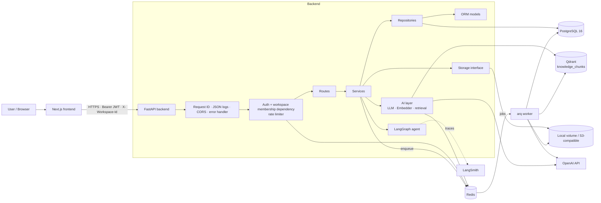
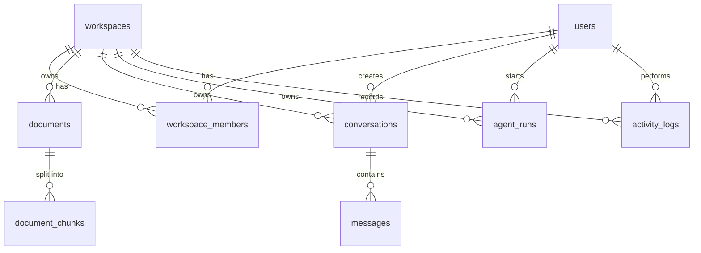
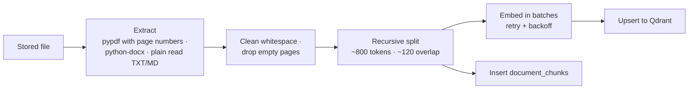
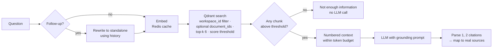

# AI Knowledge & Operations Copilot

A multi-tenant knowledge base for internal teams: upload documents, search them semantically, get grounded answers with citations, and run a multi-step analysis agent.

> **Status: design draft (Phase 1).** This README describes the planned system. No application code exists yet. Each section will be replaced with a description of what was actually built as the corresponding phase is completed.

---

## Product concept

Internal knowledge — policies, runbooks, contracts, reports — is spread across files nobody can search well. Generic chatbots either can't see those files or answer confidently without evidence.

The Copilot gives a team a private **workspace**. Members upload internal documents; the app processes and indexes them in the background, then lets the team:

- **Search** documents by meaning, not just keywords.
- **Ask** questions and get answers grounded only in their documents, with every claim tied to a numbered source (file, page, chunk, relevance score). If the knowledge base doesn't contain the answer, the app says so instead of guessing.
- **Analyze** across documents with an agent that decomposes a request, retrieves evidence in rounds, checks that every claim is supported, and shows each step it took.
- **Track** activity and real usage: documents by status, conversations, agent runs, tokens used.

Core flow: **Upload → Process → Index → Search → Ask → Retrieve → Reason → Answer → Track**

### Personas

| Persona | Role | What they do |
|---|---|---|
| Workspace owner | `owner` | Creates the workspace, adds members, uploads and deletes documents |
| Team member | `member` | Searches documents and asks questions in the assistant |
| Ops analyst | `member` | Runs the agent for cross-document analysis |

### MVP features

- Register / login (email + password)
- Workspaces with owner/member roles; owners add existing users by email
- Upload PDF, DOCX, TXT, MD with async processing and live status: `UPLOADED → PROCESSING → COMPLETED / FAILED`
- Document list (paginated, sortable, filter by status), detail, delete
- Semantic search
- Grounded chat with sources and conversation history
- LangGraph agent with a visible step trace
- Activity log
- Dashboard with real usage stats

### Permissions

| Action | owner | member |
|---|:-:|:-:|
| View documents, search, chat, run agent, view activity and stats | ✓ | ✓ |
| Upload / delete documents | ✓ | — |
| Add members | ✓ | — |

Conversations and agent runs are private to the user who created them, within their workspace.

---

## Architecture



**Components**

| Component | Responsibility |
|---|---|
| Frontend (Next.js) | UI only. Talks to the backend through a typed client using `NEXT_PUBLIC_API_URL`. Never sees provider keys. |
| Backend (FastAPI) | REST API, auth, tenant isolation, validation, RAG query path. |
| Worker (arq) | Document processing (extract → chunk → embed → index) and agent runs. Keeps slow work out of the request path. |
| PostgreSQL | Source of truth: users, workspaces, documents, chunks, conversations, agent runs, activity. |
| Qdrant | Vector search over chunks, always filtered by `workspace_id`. |
| Redis | arq job queue · per-user rate limits on `/chat`, `/search`, `/agent/run` · short-TTL cache for query embeddings. |
| Storage | Uploaded files under UUID names. Local volume in development, S3-compatible bucket in production. |

**Layering rule:** routes → services → repositories → models. Routes parse input and return schemas; services hold business logic and transactions; repositories hold all SQL. Pydantic schemas are separate from ORM models.

**Tenant isolation:** the current workspace comes from the `X-Workspace-Id` header and is verified by a single dependency that checks the user's membership. Every repository query takes the verified `workspace_id`, and the retrieval module adds a mandatory `workspace_id` filter to every Qdrant search. Tests will prove that a user cannot read, search, chat over, or delete another workspace's documents.

### Request flows

**Upload.** API validates extension, magic bytes, size (`MAX_UPLOAD_MB`, default 20) and non-emptiness → stores the file under a UUID name → inserts the document as `UPLOADED` → enqueues `process_document` → returns `202`. The worker sets `PROCESSING`, indexes the file, and sets `COMPLETED`, or `FAILED` with a readable reason. The frontend polls status while processing.

**Chat.** Membership + rate limit check → rewrite follow-ups into a standalone question → embed (Redis cache) → Qdrant search → if nothing passes the score threshold, return the fixed "not enough information" answer **without calling the LLM** → otherwise build a numbered context → LLM → map `[n]` citations to sources → persist the message with JSONB sources and token usage.

**Agent.** `POST /api/agent/run` creates an `agent_runs` row and enqueues it (`202`). The worker executes the graph and writes the step trace as it goes; the UI polls `GET /api/agent/runs/{id}` to render the timeline. Multi-step runs can exceed HTTP timeouts, so they don't run inside the request.

---

## Database design

PostgreSQL 16, managed by Alembic migrations only. All tables have UUID primary keys and `created_at` / `updated_at`. Status fields are `VARCHAR` with `CHECK` constraints (easier to evolve in migrations than native enums).



| Table | Key columns | FKs (`ON DELETE`) | Constraints & indexes |
|---|---|---|---|
| `users` | email, password_hash, full_name, is_active | — | `UNIQUE(email)` (stored lowercased) |
| `workspaces` | name | — | — |
| `workspace_members` | workspace_id, user_id, role | workspace `CASCADE`, user `CASCADE` | `UNIQUE(workspace_id, user_id)`; `CHECK role IN (owner, member)`; index on `user_id` |
| `documents` | workspace_id, uploaded_by_id, filename, storage_key, content_type, size_bytes, status, error_message, page_count, chunk_count, processed_at | workspace `CASCADE`, uploader `SET NULL` | `CHECK status IN (UPLOADED, PROCESSING, COMPLETED, FAILED)`; index `(workspace_id, status, created_at)`; index on `uploaded_by_id` |
| `document_chunks` | document_id, workspace_id, chunk_index, page, text, token_count | document `CASCADE`, workspace `CASCADE` | `UNIQUE(document_id, chunk_index)`; index on `workspace_id` |
| `conversations` | workspace_id, user_id, title | workspace `CASCADE`, user `CASCADE` | index `(workspace_id, user_id, updated_at)` |
| `messages` | conversation_id, role, content, sources `JSONB`, insufficient_context, prompt_tokens, completion_tokens | conversation `CASCADE` | `CHECK role IN (user, assistant)`; index `(conversation_id, created_at)` |
| `agent_runs` | workspace_id, user_id, request, status, classification, trace `JSONB`, final_answer, sources `JSONB`, is_partial, prompt_tokens, completion_tokens, error, started_at, finished_at | workspace `CASCADE`, user `SET NULL` | `CHECK status IN (QUEUED, RUNNING, COMPLETED, FAILED)`; index `(workspace_id, created_at)`; index on `user_id` |
| `activity_logs` | workspace_id, user_id, action, entity_type, entity_id, details `JSONB` | workspace `CASCADE`, user `SET NULL` | index `(workspace_id, created_at)`; index on `user_id` |

All nine tables from the brief are kept. `document_chunks` duplicates chunk text that also lives in the Qdrant payload, deliberately: it lets the agent's document-metadata tool query in SQL, lets Qdrant be rebuilt from Postgres, and keeps chunk counts accurate for stats.

**SQL concepts the code will use**

- **JOINs:** membership checks (`workspace_members` ⋈ `workspaces`); dashboard stats.
- **Aggregation:** document counts `GROUP BY status`; `SUM` of prompt + completion tokens across `messages` and `agent_runs`.
- **Pagination and sorting:** documents, conversations, and activity (`limit`/`offset` with whitelisted sort columns).
- **Transactions:** register creates user + workspace + owner membership atomically; document delete removes the row and chunks in one transaction, then deletes the file and Qdrant points.

---

## AI / RAG design

**Models (configurable):** `OPENAI_CHAT_MODEL` (default `gpt-4o-mini`), `OPENAI_EMBEDDING_MODEL` (default `text-embedding-3-small`, 1536 dims), via `langchain-openai`. Both sit behind interfaces (`LLM`, `Embedder`) with fake implementations, so tests and CI run without an OpenAI key.

### Indexing (worker)



- **Chunk size ~800 tokens** (measured with tiktoken): large enough to hold a full paragraph or procedure with its context, small enough that 6 retrieved chunks fit comfortably in the context budget and each citation points to a specific passage.
- **Overlap ~120 tokens (15%)**: a sentence that straddles a boundary still appears whole in at least one chunk, without inflating the index much.
- **Deterministic point IDs**: `uuid5(document_id, chunk_index)`, used as both the `document_chunks` primary key and the Qdrant point ID, so re-processing overwrites instead of duplicating.
- **Qdrant collection** `knowledge_chunks`, cosine distance, payload indexes on `workspace_id` and `document_id`. Payload: `document_id, workspace_id, filename, page, chunk_index, source, created_at, text`.
- A PDF with no extractable text (e.g. a scan) ends as `FAILED: no extractable text`. OCR is out of scope.

### Query



- Retrieval is a small in-house module rather than a LangChain vector-store wrapper, so the `workspace_id` filter cannot be bypassed.
- **Sources** returned with every answer: document id, filename, page, chunk index, score. Citations that don't match a context chunk are dropped.
- **Prompt-injection defense:** document text is placed in clearly delimited blocks and the system prompt tells the model to treat it as data and ignore any instructions it contains.
- Tunables: `RETRIEVAL_TOP_K` (6), `RETRIEVAL_SCORE_THRESHOLD` (calibrated against `text-embedding-3-small` in Phase 6), `CONTEXT_TOKEN_BUDGET` (6000, above 6 × 800).

---

## LangGraph agent

`StateGraph` with typed state: `request, workspace_id, classification, sub_questions, retrieved_chunks, analysis, tool_results, retrieval_rounds, validation, final_answer, sources, status, error`.


**Tools (real ones only):**
- **Knowledge retrieval:** the same workspace-filtered retrieval used by chat.
- **Document metadata:** which documents mention X; groups findings by document.

**Persistence:** each run is stored in `agent_runs` with status, a per-node trace with timings, output, sources, token usage, and error.

**LangSmith:** enabled with `LANGSMITH_TRACING`, `LANGSMITH_API_KEY`, `LANGSMITH_PROJECT`. Runs are tagged with `workspace_id` and run type. With tracing off, behavior is identical.

---

## API

All routes are under `/api`. Swagger UI at `/docs`. Tenant routes require `Authorization: Bearer <JWT>` and `X-Workspace-Id`.

| Method | Path | Notes |
|---|---|---|
| POST | `/api/auth/register` | Creates user + default workspace + owner membership in one transaction. `201` |
| POST | `/api/auth/login` | Returns JWT |
| GET | `/api/auth/me` | Current user and memberships |
| GET / POST | `/api/workspaces` | List mine / create (creator becomes owner) |
| POST | `/api/workspaces/{id}/members` | Owner only: add an existing user by email |
| POST | `/api/documents/upload` | Owner only. `202`, enqueues processing |
| GET | `/api/documents` | Paginated, sortable, filter by status |
| GET / DELETE | `/api/documents/{id}` | Delete (owner only) removes file, chunks, Qdrant points. `204` |
| POST | `/api/search` | Ranked chunks with snippet and score. Rate-limited |
| POST | `/api/chat` | Create/continue a conversation; answer + sources. Rate-limited |
| GET | `/api/conversations`, `/api/conversations/{id}` | Paginated |
| POST | `/api/agent/run` | `202`, enqueues the run. Rate-limited |
| GET | `/api/agent/runs/{id}` | Includes step trace |
| GET | `/api/activity` | Paginated |
| GET | `/api/stats` | Real dashboard numbers |
| GET | `/api/health` | Postgres, Redis, Qdrant reported separately |

**Errors** always use one shape, with no stack traces:

```json
{"error": {"code": "document_not_found", "message": "Document not found", "details": null}}
```

Status codes: `201, 202, 204, 400, 401, 403/404, 413, 415, 422, 429` (with `Retry-After`).

**Auth:** argon2 password hashing; short-lived JWT (default 60 minutes, no refresh token in the MVP) sent as `Authorization: Bearer`.

---

## Tech stack

| Area | Choice |
|---|---|
| Backend | Python 3.12, FastAPI, SQLAlchemy 2.0 async (asyncpg), Alembic, Pydantic v2, pydantic-settings |
| Database | PostgreSQL 16 |
| Vectors | Qdrant |
| Jobs / cache / rate limits | arq on Redis |
| AI | OpenAI via langchain-openai, LangChain text splitters, LangGraph, LangSmith |
| Auth | argon2, JWT |
| Frontend | Next.js App Router, TypeScript (strict), Tailwind, shadcn/ui, TanStack Query |
| Tests | pytest, pytest-asyncio, httpx AsyncClient; ESLint, `tsc --noEmit`, `next build` |
| Lint | ruff, mypy; ESLint, Prettier |
| Local run | Docker Compose |
| CI | GitHub Actions |

---

## Project structure (planned)

```
.
├── README.md · BUILD.md · .env.example · docker-compose.yml
├── .github/workflows/ci.yml
├── docs/        architecture · database · ai-architecture · deployment · security · interview-prep
├── scripts/     smoke_openai.py (real-API check) · verify_deployment.py (live checks)
├── backend/
│   ├── app/
│   │   ├── api/         routes/ and dependencies.py (auth + workspace isolation)
│   │   ├── core/        config, security, logging, errors, rate_limit
│   │   ├── db/          async session and declarative base
│   │   ├── models/      SQLAlchemy ORM models
│   │   ├── schemas/     Pydantic request/response models
│   │   ├── repositories/ all SQL
│   │   ├── services/    business logic and transactions
│   │   ├── ai/          LLM, embeddings, prompts, retrieval
│   │   ├── rag/         extraction, chunking, indexing, chain
│   │   ├── agents/      LangGraph graph, state, tools
│   │   ├── workers/     arq tasks and settings
│   │   └── main.py      app factory
│   ├── tests/           unit/ · api/ · integration/ · fixtures/
│   └── alembic/ · pyproject.toml · requirements*.txt · Dockerfile
└── frontend/            Next.js app · Dockerfile
```

---

## Deployment plan

**Local:** `docker compose up --build` starts frontend, backend, worker, Postgres, Redis, and Qdrant. Migrations run automatically before the backend starts.

**Production:**

| Component | Host |
|---|---|
| Frontend | Vercel |
| Backend API + arq worker | Render (Railway or Fly.io as alternatives) |
| PostgreSQL | Neon |
| Redis | Upstash |
| Vectors | Qdrant Cloud (free tier) |
| File storage | S3-compatible (Cloudflare R2) |

Migrations run as a release command before the new backend version serves traffic. All configuration comes from environment variables; the full list will live in `.env.example` and `docs/deployment.md`. Main groups:

- **App:** `ENVIRONMENT`, `ALLOWED_ORIGINS`, `JWT_SECRET_KEY`, `JWT_EXPIRE_MINUTES`, `MAX_UPLOAD_MB`
- **Data:** `DATABASE_URL`, `REDIS_URL`, `QDRANT_URL`, `QDRANT_API_KEY`
- **Storage:** `STORAGE_BACKEND`, `S3_ENDPOINT_URL`, `S3_BUCKET`, `S3_ACCESS_KEY_ID`, `S3_SECRET_ACCESS_KEY`
- **AI:** `OPENAI_API_KEY`, `OPENAI_CHAT_MODEL`, `OPENAI_EMBEDDING_MODEL`, `RETRIEVAL_TOP_K`, `RETRIEVAL_SCORE_THRESHOLD`, `CONTEXT_TOKEN_BUDGET`
- **Observability:** `LANGSMITH_TRACING`, `LANGSMITH_API_KEY`, `LANGSMITH_PROJECT`, `LOG_LEVEL`
- **Frontend:** `NEXT_PUBLIC_API_URL` only

**Cost note:** Render background workers and heavy arq polling against Upstash may exceed free tiers. The final hosting layout will be confirmed during deployment.

A post-deploy script (`scripts/verify_deployment.py`) will check health, register, login, upload → COMPLETED, search, chat with sources, agent, and cross-user isolation against the live backend.
