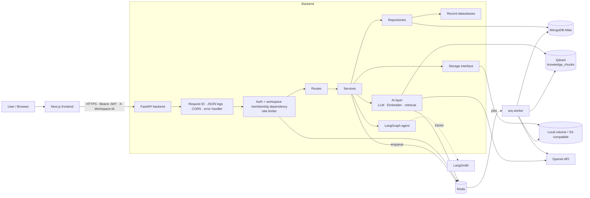
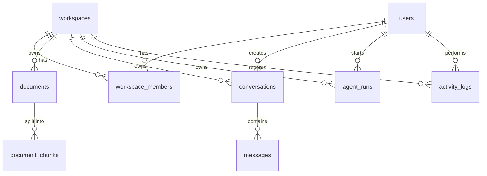
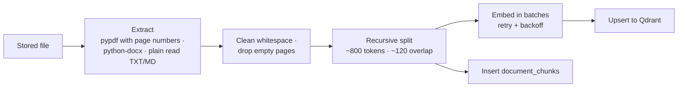
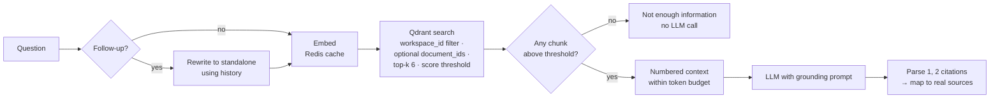
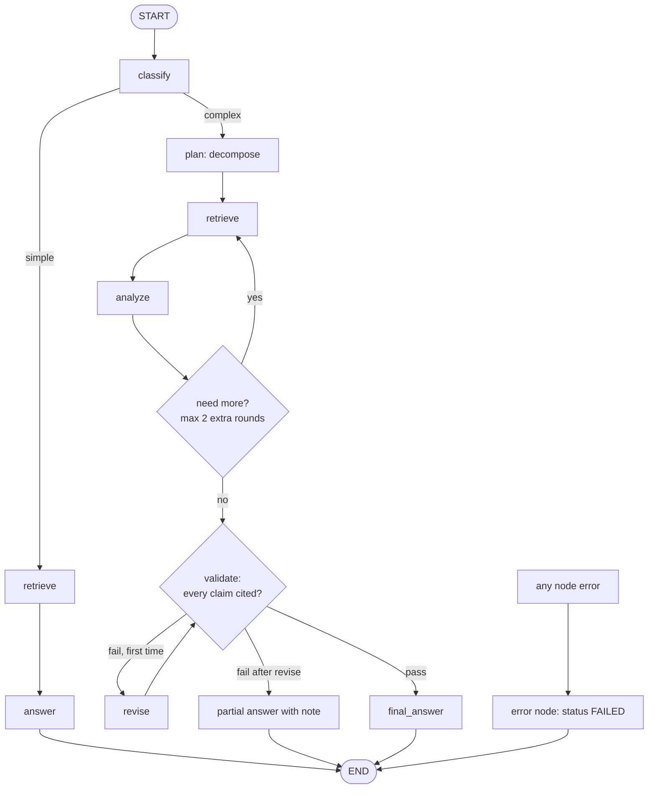

# AI Knowledge & Operations Copilot

A multi-tenant knowledge base for internal teams: upload documents, search them semantically, get grounded answers with citations, and run a multi-step analysis agent.

> **Status: in development.** This README is still the Phase 1 design; it will be rewritten to describe what was built. Implemented so far: the FastAPI foundation, database schema and migration, auth and workspaces, document upload with the arq/Redis worker (extract → chunk → embed → Qdrant), semantic search, and the frontend. Chat and the agent are not built yet, and nothing has been verified end to end with Docker Compose. See the Progress notes in BUILD.md.

---

## Product concept

Internal knowledge — policies, runbooks, contracts, reports — is spread across files nobody can search well. Generic chatbots either can't see those files or answer confidently without evidence.

The Copilot gives a team a private **workspace**. Members upload internal documents; the app processes and indexes them in the background, then lets the team:

- **Search** documents by meaning, not just keywords.
- **Ask** questions and get answers grounded only in their documents, with every claim tied to a numbered source (file, page, chunk, relevance score). If the knowledge base doesn't contain the answer, the app says so instead of guessing.
- **Analyze** across documents with an agent that decomposes a request, retrieves evidence in rounds, checks that every claim is supported, and shows each step it took.
- **Track** activity and real usage: documents by status, conversations, agent runs, tokens used.

Core flow: **Upload → Process → Index → Search → Ask → Retrieve → Reason → Answer → Track**

### Personas

| Persona | Role | What they do |
|---|---|---|
| Workspace owner | `owner` | Creates the workspace, adds members, uploads and deletes documents |
| Team member | `member` | Searches documents and asks questions in the assistant |
| Ops analyst | `member` | Runs the agent for cross-document analysis |

### MVP features

- Register / login (email + password)
- Workspaces with owner/member roles; owners add existing users by email
- Upload PDF, DOCX, TXT, MD with async processing and live status: `UPLOADED → PROCESSING → COMPLETED / FAILED`
- Document list (paginated, sortable, filter by status), detail, delete
- Semantic search
- Grounded chat with sources and conversation history
- LangGraph agent with a visible step trace
- Activity log
- Dashboard with real usage stats

### Permissions

| Action | owner | member |
|---|:-:|:-:|
| View documents, search, chat, run agent, view activity and stats | ✓ | ✓ |
| Upload / delete documents | ✓ | — |
| Add members | ✓ | — |

Conversations and agent runs are private to the user who created them, within their workspace.

---

## Architecture



**Components**

| Component | Responsibility |
|---|---|
| Frontend (Next.js) | UI only. Talks to the backend through a typed client using `NEXT_PUBLIC_API_URL`. Never sees provider keys. |
| Backend (FastAPI) | REST API, auth, tenant isolation, validation, RAG query path. |
| Worker (arq) | Document processing (extract → chunk → embed → index) and agent runs. Keeps slow work out of the request path. |
| MongoDB Atlas | Source of truth: users, workspaces, documents, chunks, conversations, agent runs, activity. Cloud-hosted; nothing runs locally. |
| Qdrant | Vector search over chunks, always filtered by `workspace_id`. |
| Redis | arq job queue · per-user rate limits on `/chat`, `/search`, `/agent/run` · short-TTL cache for query embeddings. |
| Storage | Uploaded files under UUID names. Local volume in development, S3-compatible bucket in production. |

**Layering rule:** routes → services → repositories → models. Routes parse input and return schemas; services hold business logic and transactions; repositories hold all database queries. Pydantic schemas are separate from the stored records.

**Tenant isolation:** the current workspace comes from the `X-Workspace-Id` header and is verified by a single dependency that checks the user's membership. Every repository query takes the verified `workspace_id`, and the retrieval module adds a mandatory `workspace_id` filter to every Qdrant search. Tests prove that a user cannot read, search, chat over, run the agent over, or delete another workspace's documents (offline, against MongoDB Atlas, and against the real OpenAI + Qdrant Cloud in `tests/live/`).

### Request flows

**Upload.** API validates extension, magic bytes, size (`MAX_UPLOAD_MB`, default 20) and non-emptiness → stores the file under a UUID name → inserts the document as `UPLOADED` → enqueues `process_document` → returns `202`. The worker sets `PROCESSING`, indexes the file, and sets `COMPLETED`, or `FAILED` with a readable reason. The frontend polls status while processing.

**Chat.** Membership + rate limit check → rewrite follow-ups into a standalone question → embed (Redis cache) → Qdrant search → if nothing passes the score threshold, return the fixed "not enough information" answer **without calling the LLM** → otherwise build a numbered context → LLM → keep only `[n]` citations that match a passage that was sent, and return those passages as sources → save the question and answer (with sources and token usage) in one transaction.

**Agent.** `POST /api/agent/run` creates an `agent_runs` row and enqueues it (`202`). The worker executes the graph and writes the step trace as it goes; the UI polls `GET /api/agent/runs/{id}` to render the timeline. Multi-step runs can exceed HTTP timeouts, so they don't run inside the request.

---

## Database design

MongoDB Atlas (cloud), accessed with PyMongo's native async API. The project originally used PostgreSQL 16 with Alembic; it was migrated to Atlas so that no database runs locally (see BUILD.md, *Notes*). The API contract did not change.

- **IDs:** every `_id` is a UUID stored as BSON binary subtype 4, so the API still returns the same UUID strings. All documents have `created_at` / `updated_at`.
- **Schema:** `app/db/mongo_schema.py` declares the nine collections with `$jsonSchema` validators (they mirror the old `CHECK` constraints: enum values for statuses and roles, lowercase emails, `size_bytes >= 1`, `chunk_index >= 0`) and their indexes. `ensure_schema` is idempotent and runs at API and worker startup, and from the seed script; a missing collection or index is created, and existing data is never touched.



| Collection | Key fields | Validators & indexes |
|---|---|---|
| `users` | email, password_hash, full_name, is_active | email lowercase; unique `uq_users_email` |
| `workspaces` | name | — |
| `workspace_members` | workspace_id, user_id, role | role in (owner, member); unique `(workspace_id, user_id)`; index on `user_id` |
| `documents` | workspace_id, uploaded_by_id, filename, storage_key, content_type, size_bytes, status, error_message, page_count, chunk_count, processed_at | status in (UPLOADED, PROCESSING, COMPLETED, FAILED); `(workspace_id, status, created_at)`; `(workspace_id, created_at)`; unique `storage_key` |
| `document_chunks` | document_id, workspace_id, chunk_index, page, text, token_count | unique `(document_id, chunk_index)`; index on `workspace_id` |
| `conversations` | workspace_id, user_id, title | `(workspace_id, user_id, updated_at)` |
| `messages` | conversation_id, workspace_id, role, content, sources, insufficient_context, prompt_tokens, completion_tokens | role in (user, assistant); `(conversation_id, created_at)`; index on `workspace_id` |
| `agent_runs` | workspace_id, user_id, request, status, classification, trace, final_answer, sources, is_partial, tokens, error, started_at, finished_at | status in (QUEUED, RUNNING, COMPLETED, FAILED); `(workspace_id, created_at)` |
| `activity_logs` | workspace_id, user_id, action, entity_type, entity_id, details | `(workspace_id, created_at)` |

`document_chunks` duplicates chunk text that also lives in the Qdrant payload, deliberately: it lets Qdrant be rebuilt from the database and keeps chunk counts accurate for stats. `messages` carries a denormalized `workspace_id` so token totals can be computed per workspace without a join.

**How the relational guarantees are kept**

- **Transactions:** registration (user + workspace + owner membership + activity), workspace creation, adding a member, upload, delete, and the worker's `complete` / `fail` transitions each run in one multi-document transaction (`Mongo.transaction`). Any error rolls the whole unit back.
- **Cascades:** there are no foreign keys; deleting a document removes its chunks and records the activity in the same transaction, then deletes the Qdrant points and the stored file.
- **Uniqueness:** unique indexes; a `DuplicateKeyError` is mapped to the same 409 errors as before.
- **Aggregation:** document counts use `$group` by status; token totals use `$group` sums over `messages` and `agent_runs`.
- **Pagination and sorting:** `count_documents` + `find().sort().skip().limit()`, with whitelisted sort fields and `_id` as a tie-breaker.

Development data: `backend/scripts/seed_mongodb.py` (idempotent upserts; see `backend/seed_data/README.md`).

---

## AI / RAG design

**Models (configurable):** `OPENAI_CHAT_MODEL` (default `gpt-4o-mini`), `OPENAI_EMBEDDING_MODEL` (default `text-embedding-3-small`, 1536 dims), via `langchain-openai`. Both sit behind interfaces (`LLM`, `Embedder`) with fake implementations, so tests and CI run without an OpenAI key.

### Indexing (worker)



- **Chunk size ~800 tokens** (measured with tiktoken): large enough to hold a full paragraph or procedure with its context, small enough that 6 retrieved chunks fit comfortably in the context budget and each citation points to a specific passage.
- **Overlap ~120 tokens (15%)**: a sentence that straddles a boundary still appears whole in at least one chunk, without inflating the index much.
- **Deterministic point IDs**: `uuid5(document_id, chunk_index)`, used as both the `document_chunks` primary key and the Qdrant point ID, so re-processing overwrites instead of duplicating.
- **Qdrant collection** `knowledge_chunks`, cosine distance, payload indexes on `workspace_id` and `document_id`. Payload: `document_id, workspace_id, filename, page, chunk_index, source, created_at, text`.
- A PDF with no extractable text (e.g. a scan) ends as `FAILED: no extractable text`. OCR is out of scope.

### Query



- Retrieval is a small in-house module (`KnowledgeRetriever`) rather than a LangChain vector-store wrapper, so the `workspace_id` filter cannot be bypassed. Search, chat and the agent all use it. Qdrant calls retry transient failures (network errors, 5xx, 429) up to 3 times with backoff; a cloud load balancer can drop an idle connection.
- **Sources** returned with every answer: document id, filename, page, chunk index, score. Citations that don't match a context chunk are dropped.
- **Prompt-injection defense:** document text is HTML-escaped and placed in `<context><source index=…>` blocks in the user message (never the system message), so a document cannot close the block or fake a system section. The system prompt ranks its own rules first, tells the model to treat the passages as data and ignore instructions inside them, and forbids revealing the prompt, configuration or credentials. Verified against the real model in `tests/live/`.
- **Partial coverage:** if the passages answer only part of a question, the model answers that part and says what the knowledge base does not cover.
- **Conversations** are private to the user who created them (another member, or another workspace, gets `404`). Follow-ups use the last `CHAT_HISTORY_MESSAGES` messages (default 6) only to rewrite the question.
- Tunables: `RETRIEVAL_TOP_K` (6), `RETRIEVAL_SCORE_THRESHOLD` (0.3), `CONTEXT_TOKEN_BUDGET` (6000, above 6 × 800), `OPENAI_CHAT_MODEL` (`gpt-4o-mini`, temperature 0, `LLM_TIMEOUT_SECONDS` 60, `LLM_MAX_RETRIES` 2). `/api/chat`, `/api/search` and `/api/agent/run` are limited to `RATE_LIMIT_REQUESTS` per `RATE_LIMIT_WINDOW_SECONDS` per user (Redis; `429` with `Retry-After`).

---

## LangGraph agent

`StateGraph` with typed state: `request, workspace_id, classification, sub_questions, retrieved_chunks, analysis, tool_results, retrieval_rounds, validation, final_answer, sources, status, error`.



**Tools (real ones only):** both are bound to the run's workspace when they are created, so the model never chooses a workspace, and the graph (not the model) decides when they run. There is no open-ended tool.
- **Knowledge retrieval:** the same workspace-filtered retrieval used by search and chat.
- **Document metadata:** which documents the findings come from: passages grouped by document, with details read from MongoDB (also filtered to the workspace).

**Persistence:** each run is stored in `agent_runs` with status (`QUEUED → RUNNING → COMPLETED/FAILED`), a per-node trace with timings and a short summary (written as each node finishes, so the UI shows progress), output, sources, token usage, and a user-safe error. Runs are private to the user who started them. Activity: `agent.run_started`, `agent.run_completed`, `agent.run_failed`. Validation is checked twice: deterministically (the answer must cite at least one passage that was sent) and by the model (every claim supported).

**LangSmith:** set `LANGSMITH_TRACING=true`, `LANGSMITH_API_KEY` and optionally `LANGSMITH_PROJECT` (default `copilot`) in `.env`, restart the worker, then open the project in LangSmith: each run appears as `knowledge_agent`, tagged `agent` and `workspace:<id>`, with `agent_run_id` in its metadata. With tracing off, behavior is identical.

---

## API

All routes are under `/api`. Swagger UI at `/docs`. Tenant routes require `Authorization: Bearer <JWT>` and `X-Workspace-Id`.

| Method | Path | Notes |
|---|---|---|
| POST | `/api/auth/register` | Creates user + default workspace + owner membership in one transaction. `201` |
| POST | `/api/auth/login` | Returns JWT |
| GET | `/api/auth/me` | Current user and memberships |
| GET / POST | `/api/workspaces` | List mine / create (creator becomes owner) |
| POST | `/api/workspaces/{id}/members` | Owner only: add an existing user by email |
| POST | `/api/documents/upload` | Owner only. `202`, enqueues processing |
| GET | `/api/documents` | Paginated, sortable, filter by status |
| GET / DELETE | `/api/documents/{id}` | Delete (owner only) removes file, chunks, Qdrant points. `204` |
| POST | `/api/search` | Ranked chunks with snippet and score. Rate-limited |
| POST | `/api/chat` | `{message, conversation_id?}` → `{conversation_id, message}`; the message has `content` with `[n]` citations, `sources[]` (index, document_id, filename, page, chunk_index, score, snippet) and `insufficient_context`. Creates the conversation if `conversation_id` is omitted. Rate-limited |
| GET | `/api/conversations`, `/api/conversations/{id}` | Your conversations, most recent first (paginated); one conversation with its messages in order |
| POST | `/api/agent/run` | `{request}` → `202` with the `QUEUED` run; executed by the worker. Rate-limited |
| GET | `/api/agent/runs/{id}` | Status, classification, step trace (node, status, started_at, duration_ms, summary), final_answer, sources, is_partial, tokens, error |
| GET | `/api/activity` | Paginated |
| GET | `/api/stats` | Real dashboard numbers |
| GET | `/api/health` | MongoDB (real `ping`), Redis, Qdrant reported separately |

**Errors** always use one shape, with no stack traces:

```json
{"error": {"code": "document_not_found", "message": "Document not found", "details": null}}
```

Status codes: `201, 202, 204, 400, 401, 403/404, 413, 415, 422, 429` (with `Retry-After`).

**Auth:** argon2 password hashing; short-lived JWT (default 60 minutes, no refresh token in the MVP) sent as `Authorization: Bearer`.

---

## Tech stack

| Area | Choice |
|---|---|
| Backend | Python 3.12, FastAPI, PyMongo async, Pydantic v2, pydantic-settings |
| Database | MongoDB Atlas (cloud) |
| Vectors | Qdrant |
| Jobs / cache / rate limits | arq on Redis |
| AI | OpenAI via langchain-openai, LangChain text splitters, LangGraph, LangSmith |
| Auth | argon2, JWT |
| Frontend | Next.js App Router, TypeScript (strict), Tailwind, shadcn/ui, TanStack Query |
| Tests | pytest, pytest-asyncio, httpx AsyncClient; ESLint, `tsc --noEmit`, `next build` |
| Lint | ruff, mypy; ESLint, Prettier |
| Local run | `uvicorn` + `npm run dev` (Docker Compose optional; no database container) |
| CI | GitHub Actions |

---

## Project structure (planned)

```
.
├── README.md · BUILD.md · .env.example · docker-compose.yml
├── .github/workflows/ci.yml
├── docs/        architecture · database · ai-architecture · deployment · security · interview-prep
├── scripts/     smoke_openai.py (real-API check) · verify_deployment.py (live checks)
├── backend/
│   ├── app/
│   │   ├── api/         routes/ and dependencies.py (auth + workspace isolation)
│   │   ├── core/        config, security, logging, errors, rate_limit
│   │   ├── db/          MongoDB client, transactions, collections + indexes
│   │   ├── models/      record dataclasses and enums
│   │   ├── schemas/     Pydantic request/response models
│   │   ├── repositories/ all database queries
│   │   ├── services/    business logic and transactions
│   │   ├── ai/          LLM, embeddings, prompts, retrieval
│   │   ├── rag/         extraction, chunking, indexing, chain
│   │   ├── agents/      LangGraph graph, state, tools
│   │   ├── workers/     arq tasks and settings
│   │   └── main.py      app factory
│   ├── tests/           unit/ · api/ · integration/ · fixtures/
│   ├── scripts/ · seed_data/   Atlas seed script and JSON fixtures
│   └── pyproject.toml · requirements*.txt · Dockerfile
└── frontend/            Next.js app · Dockerfile
```

---

## Deployment plan

**Local:** set `MONGODB_URI` / `MONGODB_DATABASE` in `.env`, then `python -m uvicorn app.main:app` in `backend/` and `npm run dev` in `frontend/`. The collections and indexes are created on startup. Document processing additionally needs Redis (`REDIS_URL`), Qdrant (`QDRANT_URL`) and `OPENAI_API_KEY`, plus the worker: `python -m arq app.workers.settings.WorkerSettings`. Optionally, `docker compose up --build` runs Redis, Qdrant, backend, worker and frontend; the database is still Atlas.

**Production:**

| Component | Host |
|---|---|
| Frontend | Vercel |
| Backend API + arq worker | Render (Railway or Fly.io as alternatives) |
| Database | MongoDB Atlas |
| Redis | Upstash |
| Vectors | Qdrant Cloud (free tier) |
| File storage | S3-compatible (Cloudflare R2) |

There are no migrations: collections, validators and indexes are ensured idempotently at startup. All configuration comes from environment variables; the full list will live in `.env.example` and `docs/deployment.md`. Main groups:

- **App:** `ENVIRONMENT`, `ALLOWED_ORIGINS`, `JWT_SECRET_KEY`, `JWT_EXPIRE_MINUTES`, `MAX_UPLOAD_MB`
- **Data:** `MONGODB_URI`, `MONGODB_DATABASE`, `REDIS_URL`, `QDRANT_URL`, `QDRANT_API_KEY`
- **Storage:** `STORAGE_BACKEND`, `S3_ENDPOINT_URL`, `S3_BUCKET`, `S3_ACCESS_KEY_ID`, `S3_SECRET_ACCESS_KEY`
- **AI:** `OPENAI_API_KEY`, `OPENAI_CHAT_MODEL`, `OPENAI_EMBEDDING_MODEL`, `RETRIEVAL_TOP_K`, `RETRIEVAL_SCORE_THRESHOLD`, `CONTEXT_TOKEN_BUDGET`
- **Observability:** `LANGSMITH_TRACING`, `LANGSMITH_API_KEY`, `LANGSMITH_PROJECT`, `LOG_LEVEL`
- **Frontend:** `NEXT_PUBLIC_API_URL` only

**Cost note:** Render background workers and heavy arq polling against Upstash may exceed free tiers. The final hosting layout will be confirmed during deployment.

A post-deploy script (`scripts/verify_deployment.py`) will check health, register, login, upload → COMPLETED, search, chat with sources, agent, and cross-user isolation against the live backend.
