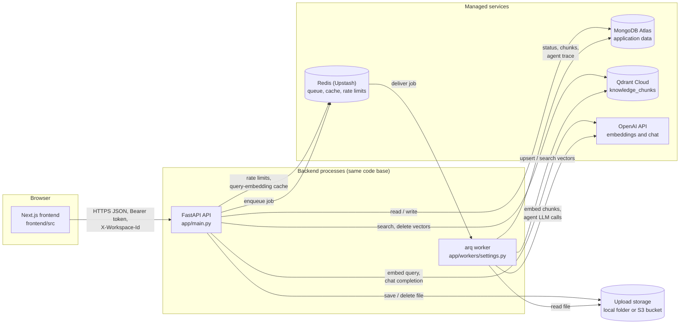
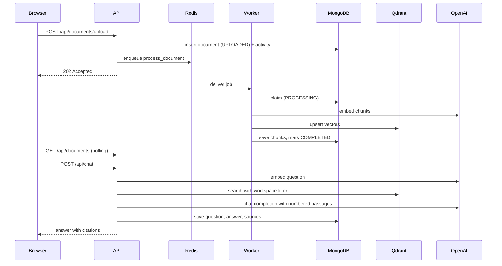
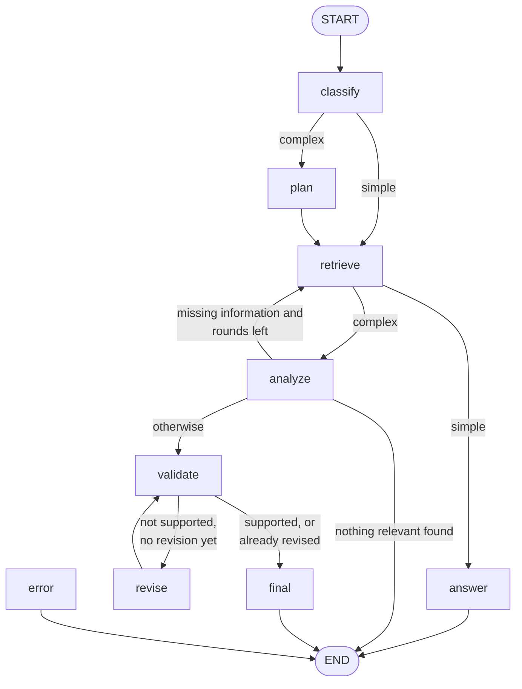
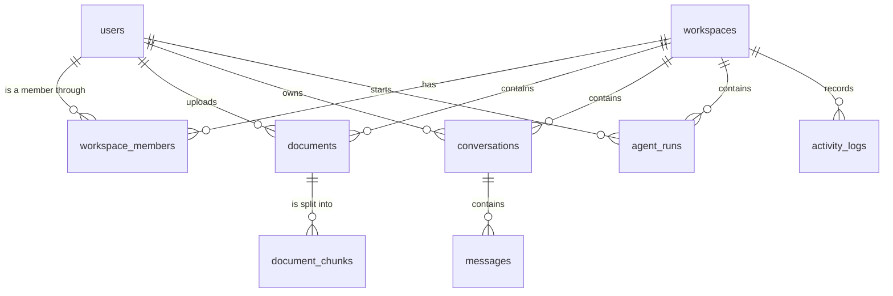

# Knowledge Copilot: Technical Stack and Module Guide

**Generated:** 9 October 2026
**Project:** AI Knowledge & Operations Copilot (`production-rag-assistant`)
**Source of truth:** the code in the working tree on the generation date. Where `README.md` or `BUILD.md` disagree with the code, this guide follows the code and lists the disagreement in [section 13](#13-implementation-status-and-gaps).

This guide explains what every technology, dependency and module in the project does, how a document becomes a cited answer, and what is and is not finished. It contains no credentials: every secret is shown as a placeholder.

## Table of contents

1. [Technology stack overview](#1-technology-stack-overview)
2. [Backend dependencies explained](#2-backend-dependencies-explained)
3. [Frontend dependencies explained](#3-frontend-dependencies-explained)
4. [Project modules and file responsibilities](#4-project-modules-and-file-responsibilities)
5. [System architecture](#5-system-architecture)
6. [Document upload to RAG answer](#6-document-upload-to-rag-answer)
7. [RAG assistant vs. agent](#7-rag-assistant-vs-agent)
8. [MongoDB collections and relationships](#8-mongodb-collections-and-relationships)
9. [Environment variables reference](#9-environment-variables-reference)
10. [API endpoints reference](#10-api-endpoints-reference)
11. [Development setup and commands](#11-development-setup-and-commands)
12. [Authentication, authorization, and security](#12-authentication-authorization-and-security)
13. [Implementation status and gaps](#13-implementation-status-and-gaps)
14. [Recommended learning order](#14-recommended-learning-order)
15. [Glossary](#15-glossary)

### How to read the status labels

| Label | Meaning in this guide |
|---|---|
| Implemented and verified | The code exists and automated tests exercise it. The offline suite (201 tests) was re-run while writing this guide and passed. The integration suite (67 tests, real MongoDB Atlas and Redis) and the live suite (5 tests, real OpenAI and Qdrant Cloud) last passed in the previous working session and were not re-run for this guide. |
| Implemented but not verified | The code exists, but no test or manual run in this project has confirmed it works end to end. |
| Partially implemented | Some of the feature exists; the missing part is named. |
| Planned | Described in `README.md` or `BUILD.md`, with no code yet. |
| Missing | Not in the code and not planned in the documents, but a reader would expect it. |
| Uncertain | The code could not settle the question; what would settle it is stated. |

---

## 1. Technology stack overview

Versions are the exact pins in `backend/requirements.txt` and the versions resolved in `frontend/package-lock.json`. The installed backend packages in `backend/.venv` were compared with the pins and all match.

| Technology | Category | Version | Location | Purpose | Why this one | Alternatives | Status |
|---|---|---|---|---|---|---|---|
| Python | Language | 3.12 (3.12.10 in `backend/.venv`) | `backend/` | Backend API and worker | Modern typing (`type` parameters, `StrEnum`), mature async | Node.js, Go | Implemented and verified |
| FastAPI | Web framework | 0.141.1 | `backend/app/main.py`, `backend/app/api/` | HTTP API, dependency injection, request validation | Async-first, Pydantic validation built in, automatic OpenAPI | Django REST Framework, Flask, Litestar | Implemented and verified |
| Uvicorn | ASGI server | 0.54.0 | Started from the command line | Runs the FastAPI app | The standard server for FastAPI | Hypercorn, Granian | Implemented and verified |
| Pydantic and pydantic-settings | Validation and configuration | 2.13.5 and 2.15.0 | `backend/app/schemas/`, `backend/app/core/config.py` | Request and response models; typed settings from the environment | One library for API contracts and configuration | attrs, marshmallow, dynaconf | Implemented and verified |
| MongoDB Atlas | Primary database | Cloud service (driver: PyMongo 4.18.2) | `backend/app/db/mongo.py`, `backend/app/db/mongo_schema.py` | Users, workspaces, documents, chunks, conversations, agent runs, activity | Chosen by the project owner to replace PostgreSQL; managed, no local database to run | PostgreSQL, DynamoDB | Implemented and verified |
| Redis (Upstash) | Queue, cache, rate limits | Cloud service (client: redis 5.3.1) | `backend/app/db/redis.py` | arq job queue, query-embedding cache, rate-limit counters | One service covers three needs; Upstash works over TLS with no server to run | RabbitMQ, SQS, Memcached | Implemented and verified |
| arq | Background job queue | 0.28.0 | `backend/app/workers/`, `backend/app/services/queue.py` | Runs document processing and agent runs outside the HTTP request | Small, async-native, uses the Redis that is already there | Celery, RQ, Dramatiq | Implemented and verified |
| Qdrant Cloud | Vector database | Cloud service (client: qdrant-client 1.19.1) | `backend/app/db/qdrant.py`, `backend/app/rag/indexing.py`, `backend/app/ai/retrieval.py` | Stores chunk embeddings and answers similarity searches with a workspace filter | Payload filtering is a first-class feature, which tenant isolation depends on | pgvector, Pinecone, Weaviate, Atlas Vector Search | Implemented and verified |
| OpenAI API | Embeddings and chat model | SDK openai 3.13.0; models `text-embedding-3-small` and `gpt-4o-mini` by default | `backend/app/ai/embeddings.py`, `backend/app/ai/llm.py` | Turns text into vectors; writes answers | Good quality for cost; both models configurable through settings | Anthropic, Azure OpenAI, local models | Implemented and verified (live suite) |
| LangChain packages | LLM client wrappers and text splitter | langchain-openai 1.6.6, langchain-core 1.6.6, langchain-text-splitters 1.1.2 | `backend/app/ai/`, `backend/app/rag/chunking.py` | `ChatOpenAI`, `OpenAIEmbeddings`, message types, token-aware splitter | Thin wrappers that LangGraph and LangSmith understand | Calling the OpenAI SDK directly | Implemented and verified |
| LangGraph | Agent orchestration | 1.2.11 | `backend/app/agents/knowledge_agent.py` | The multi-step agent as a state graph with conditional edges | Explicit, testable control flow with loops and limits | A hand-written loop, CrewAI, AutoGen | Implemented and verified |
| LangSmith | Tracing (optional) | langsmith 0.14.1 is installed as a dependency of the LangChain packages; not pinned by this project | `backend/app/core/tracing.py` | Records LLM and graph runs when switched on | Works with LangChain and LangGraph with no extra code | OpenTelemetry, Langfuse | Implemented but not verified (no API key has been configured) |
| tiktoken | Tokenizer | 0.14.0 | `backend/app/rag/chunking.py`, `backend/app/rag/chain.py` | Counts tokens for chunk sizes and the context budget | It is the tokenizer the OpenAI models use | Character counts (less accurate) | Implemented and verified |
| pypdf and python-docx | Text extraction | 6.19.0 and 1.2.0 | `backend/app/rag/extraction.py` | Reads text from PDF and DOCX uploads | Pure Python, no system packages | PyMuPDF, unstructured, Apache Tika | Implemented and verified |
| argon2-cffi | Password hashing | 25.1.0 | `backend/app/core/security.py` | Hashes and verifies passwords with Argon2 | The current recommended password hash | bcrypt, scrypt | Implemented and verified |
| PyJWT | Access tokens | 2.15.1 | `backend/app/core/security.py` | Signs and checks HS256 JSON Web Tokens | Small and focused | python-jose, Authlib | Implemented and verified |
| boto3 | Object storage (optional) | 1.43.105 | `backend/app/storage/s3.py` | Stores uploads in an S3-compatible bucket when `STORAGE_BACKEND=s3` | Works with AWS S3, Cloudflare R2 and others | aioboto3, MinIO client | Implemented but not verified against a real bucket |
| Next.js | Frontend framework | 16.3.7 | `frontend/` | App Router pages, build, development server | Routing, bundling and production output in one tool | Vite with React Router, Remix | Implemented and verified (lint, typecheck, build and browser checks) |
| React | UI library | 19.2.8 | `frontend/src/` | Components | Required by Next.js | n/a | Implemented and verified |
| TypeScript | Language | 5.9.3 | `frontend/` | Static types for the frontend | Catches contract drift with the API | JavaScript with JSDoc | Implemented and verified |
| Tailwind CSS | Styling | 4.3.3 | `frontend/src/app/globals.css` | Utility classes and design tokens | No separate stylesheet per component | CSS Modules, vanilla-extract | Implemented and verified |
| shadcn components on Radix UI | Component primitives | shadcn 4.21.0, radix-ui 1.6.7 | `frontend/src/components/ui/` | Accessible dialogs, menus, tabs, selects | The component source lives in the repository, so it can be edited | MUI, Mantine, Headless UI | Implemented and verified |
| TanStack Query | Server state | 5.104.0 | `frontend/src/app/providers.tsx` and all pages | Fetching, caching, polling, retries | Polling and cache invalidation without hand-written state | SWR, RTK Query | Implemented and verified |
| Docker and Docker Compose | Packaging (optional) | Images: `python:3.12-slim`, `node:20-alpine`, `redis:7.4-alpine`, `qdrant/qdrant:v1.19.1` | `docker-compose.yml`, `backend/Dockerfile`, `frontend/Dockerfile` | Runs the API, worker, frontend, Redis and Qdrant in containers | Reproducible deployment | Running the processes directly (what local development does) | Implemented but not verified since the MongoDB migration |
| pytest, ruff, mypy | Backend quality tools | pytest 9.1.1, pytest-asyncio 1.4.0, ruff 0.16.9, mypy 2.3.1 | `backend/pyproject.toml`, `backend/tests/` | Tests, lint and format, strict type checking | Standard tools | unittest, flake8 and black, pyright | Implemented and verified |
| ESLint and Prettier | Frontend quality tools | eslint 9.39.5, prettier 3.9.9 | `frontend/eslint.config.mjs`, `frontend/.prettierrc.json` | Lint and format | Standard tools | Biome | Implemented and verified |

**Not part of the active stack.** PostgreSQL, SQLAlchemy and Alembic were used before the migration to MongoDB. No application, script or test file imports them, the `backend/alembic/` files are deleted in the working tree, and they are not in `backend/requirements.txt`. The only leftovers are four unused variable names in the local `.env` (see [section 9](#9-environment-variables-reference)) and one stale docstring (see [section 13](#13-implementation-status-and-gaps)).

---

## 2. Backend dependencies explained

All packages below are pinned in `backend/requirements.txt`. "Used by" lists every application file that imports the package.

| Package | Version | Purpose | Why it is needed | Used by | Can it be removed? |
|---|---|---|---|---|---|
| `fastapi` | 0.141.1 | Routing, dependency injection, validation, OpenAPI | The API is built on it | `backend/app/main.py`, `backend/app/api/dependencies.py`, every file in `backend/app/api/routes/`, `backend/app/core/errors.py` | No |
| `starlette` | 1.7.0 | ASGI types, HTTP exceptions, header helpers | Imported directly for the request-ID middleware and the HTTP exception handler | `backend/app/core/logging.py`, `backend/app/core/errors.py` | No. It is a FastAPI dependency anyway; the pin keeps the directly imported version explicit |
| `uvicorn[standard]` | 0.54.0 | ASGI server | Runs the app; never imported by application code | Command line, `backend/Dockerfile` | No |
| `pydantic` | 2.13.5 | Data models and validation | Request and response schemas, job payloads, settings fields | `backend/app/schemas/` (all six files), `backend/app/core/config.py`, `backend/app/core/pagination.py`, `backend/app/services/queue.py`, `backend/app/workers/tasks.py`, `backend/app/ai/embeddings.py`, `backend/app/ai/llm.py` | No |
| `pydantic-settings` | 2.15.0 | Loads settings from the environment and `.env` | The single `Settings` class | `backend/app/core/config.py`, `backend/scripts/seed_mongodb.py` | No |
| `redis[hiredis]` | 5.3.1 | Async Redis client | Cache, rate limits, health check; arq also requires `redis<6` | `backend/app/db/redis.py`, `backend/app/core/rate_limit.py`, `backend/app/ai/embeddings.py`, `backend/app/services/health.py` | No |
| `qdrant-client` | 1.19.1 | Async Qdrant client and filter models | Vector writes, deletes and searches | `backend/app/db/qdrant.py`, `backend/app/rag/indexing.py`, `backend/app/ai/retrieval.py`, `backend/app/services/health.py` | No |
| `python-multipart` | 0.0.32 | Parses `multipart/form-data` | FastAPI needs it for `UploadFile`; never imported directly | `backend/app/api/routes/documents.py` (indirectly) | No, uploads would stop working |
| `email-validator` | 2.3.0 | Validates email addresses | Pydantic's `EmailStr` needs it; never imported directly | `backend/app/schemas/auth.py`, `backend/app/schemas/workspaces.py` (indirectly) | No |
| `argon2-cffi` | 25.1.0 | Argon2 password hashing | Hashing and verifying passwords | `backend/app/core/security.py` | No |
| `PyJWT` | 2.15.1 | JSON Web Tokens | Access tokens | `backend/app/core/security.py` | No |
| `pymongo` | 4.18.2 | Official MongoDB driver with a native async API | All database access | `backend/app/db/mongo.py`, `backend/app/db/mongo_schema.py`, `backend/app/core/errors.py`, `backend/app/services/auth.py`, `backend/app/services/workspaces.py`, `backend/app/repositories/agent_runs.py`, `backend/app/repositories/document_store.py`, both scripts | No |
| `arq` | 0.28.0 | Redis-backed job queue and worker | Background processing | `backend/app/services/queue.py`, `backend/app/workers/settings.py` | No |
| `pypdf` | 6.19.0 | PDF text extraction | PDF uploads | `backend/app/rag/extraction.py` | Only if PDF support is dropped |
| `python-docx` | 1.2.0 | DOCX text extraction (imported as `docx`) | DOCX uploads | `backend/app/rag/extraction.py` | Only if DOCX support is dropped |
| `langchain-text-splitters` | 1.1.2 | `RecursiveCharacterTextSplitter` | Token-sized chunks with overlap | `backend/app/rag/chunking.py` | Yes, with a hand-written splitter |
| `langchain-openai` | 1.6.6 | `ChatOpenAI`, `OpenAIEmbeddings` | Calls to OpenAI | `backend/app/ai/llm.py`, `backend/app/ai/embeddings.py` | Yes, by calling the `openai` SDK directly, at the cost of LangSmith integration |
| `langchain-core` | 1.6.6 | Message classes, `RunnableConfig` | Imported directly | `backend/app/ai/llm.py`, `backend/app/agents/knowledge_agent.py` | No, while the two packages above stay |
| `openai` | 3.13.0 | OpenAI SDK | Imported directly to catch `openai.RateLimitError` | `backend/app/ai/llm.py` | No |
| `httpx2` | 2.13.1 | The HTTP client the OpenAI SDK uses | The app builds its own client with an explicit TLS context | `backend/app/ai/http.py` | No, see the note below |
| `certifi` | 2026.7.22 | A bundle of trusted certificate authorities | Added to the TLS context for OpenAI calls | `backend/app/ai/http.py` | No |
| `langgraph` | 1.2.11 | State-graph agent runtime | The agent | `backend/app/agents/knowledge_agent.py` | Only by rewriting the agent as a plain loop |
| `tiktoken` | 0.14.0 | Tokenizer | Chunk sizes and the context budget | `backend/app/rag/chunking.py` (and `backend/app/rag/chain.py` through `token_encoding`) | No |
| `boto3` | 1.43.105 | AWS SDK | S3-compatible upload storage | `backend/app/storage/s3.py` | Yes, if only local storage is ever used (the import in `backend/app/storage/__init__.py` would have to go too) |
| `botocore` | 1.43.105 | Low-level AWS library | Imported directly for `ClientError` | `backend/app/storage/s3.py` | Together with `boto3` |

Development-only packages, pinned in `backend/requirements-dev.txt`: `pytest` 9.1.1, `pytest-asyncio` 1.4.0, `httpx` 0.28.1, `ruff` 0.16.9, `mypy` 2.3.1.

**Two dependency details worth knowing**

- `backend/app/rag/indexing.py` imports `httpx` (to recognise `httpx.TransportError` as a retryable failure), but `httpx` is pinned only in `backend/requirements-dev.txt`. It still installs in production because `qdrant-client` depends on it. It works, but the version there is whatever `qdrant-client` resolves, not a pin.
- `backend/scripts/check_mongodb_atlas.py` imports `dns.resolver` from `dnspython`, which is not pinned either. It installs because `pymongo` depends on it.

### Usage examples from the code

**Settings** (`backend/app/core/config.py`): every setting is a typed field, secrets are `SecretStr` so they do not appear in logs or `repr` output.

```python
class Settings(BaseSettings):
    model_config = SettingsConfigDict(
        env_file=("../.env", ".env"), env_file_encoding="utf-8", extra="ignore"
    )
    mongodb_uri: SecretStr
    mongodb_database: str = Field(min_length=1)
    jwt_secret_key: SecretStr = Field(min_length=32)
```

**MongoDB client** (`backend/app/db/mongo.py`): one client per process; UUIDs are stored in the standard binary form.

```python
AsyncMongoClient(
    settings.mongodb_uri.get_secret_value(),
    uuidRepresentation="standard",
    tz_aware=True,
    serverSelectionTimeoutMS=settings.mongodb_server_selection_timeout_ms,
    appname=appname,
    event_listeners=[ConnectivityLogger()],
)
```

**Chunking** (`backend/app/rag/chunking.py`): 800-token chunks with 120 tokens of overlap, measured with the embedding model's tokenizer.

```python
RecursiveCharacterTextSplitter.from_tiktoken_encoder(
    encoding_name="cl100k_base", chunk_size=800, chunk_overlap=120
)
```

**Workspace filter** (`backend/app/ai/retrieval.py`): every vector search carries this filter; there is no search function without it.

```python
conditions = [FieldCondition(key="workspace_id", match=MatchValue(value=str(workspace_id)))]
```

**TLS for OpenAI calls** (`backend/app/ai/http.py`): by default `httpx2` verifies certificates through the `truststore` package, which on Windows calls the system certificate service during the handshake and can block the event loop. The app passes its own client that verifies with OpenSSL instead. Verification is still full (certificate chain and host name).

```python
def openai_ssl_context() -> ssl.SSLContext:
    context = ssl.create_default_context()
    context.load_verify_locations(cafile=certifi.where())
    return context
```

**Queueing a job** (`backend/app/services/queue.py`): the job ID is derived from the document ID, so the same document cannot be queued twice while a job is pending.

```python
await self._redis.enqueue_job(
    PROCESS_DOCUMENT_TASK,
    job.model_dump(mode="json"),
    _job_id=f"process-document:{job.document_id}",
)
```

---

## 3. Frontend dependencies explained

Declared in `frontend/package.json`; the version column is what `frontend/package-lock.json` resolves.

### Runtime dependencies

| Package | Version | Purpose | Used by | Can it be removed? |
|---|---|---|---|---|
| `next` | 16.3.7 | Framework: App Router, build, `next/font`, `next/navigation` | Every page and layout under `frontend/src/app/` | No |
| `react`, `react-dom` | 19.2.8 | UI library | Everything | No |
| `@tanstack/react-query` | 5.104.0 | Fetching, caching, polling, mutations | `frontend/src/app/providers.tsx`, all pages, most components that load data | No, without rewriting all data loading |
| `radix-ui` | 1.6.7 | Accessible unstyled primitives (dialog, dropdown, select, tabs) | The files in `frontend/src/components/ui/` | No |
| `shadcn` | 4.21.0 | Supplies `shadcn/tailwind.css`, imported by `frontend/src/app/globals.css` | `frontend/src/app/globals.css` | Not without copying that stylesheet in |
| `class-variance-authority` | 0.7.1 | Variant helper for component classes | `frontend/src/components/ui/` (for example button and badge) | Yes, with hand-written class maps |
| `cn` | 0.4.0 | Class-name merging helper | `frontend/src/lib/utils.ts` re-exports it; the `ui` components import it directly | Yes, with `clsx` plus `tailwind-merge` |
| `lucide-react` | 1.48.0 | Icons | Pages and components | Yes, with another icon set |
| `sonner` | 2.0.8 | Toast notifications | `frontend/src/components/ui/sonner.tsx`, mounted in `frontend/src/app/providers.tsx` | Yes |
| `tw-animate-css` | 1.4.0 | Animation utility classes | `frontend/src/app/globals.css` | Yes, if the animated components are restyled |

### Development dependencies

| Package | Version | Purpose |
|---|---|---|
| `typescript` | 5.9.3 | Type checking (`npm run typecheck`) |
| `tailwindcss`, `@tailwindcss/postcss` | 4.3.3 | Styling; wired in `frontend/postcss.config.mjs` |
| `eslint`, `eslint-config-next`, `eslint-config-prettier` | 9.39.5, 16.3.7, 10.1.8 | Lint (`npm run lint`); `no-console` is an error |
| `prettier`, `prettier-plugin-tailwindcss` | 3.9.9, 0.8.1 | Formatting (`npm run format`) |
| `@types/node`, `@types/react`, `@types/react-dom` | 20.19.43, 19.3.0, 19.3.0 | Type definitions |

### What the frontend deliberately does not use

No form library, no schema validation library, no chart library and no global state library. Forms use plain React state, server state lives in TanStack Query, and the two values that must survive a reload (the access token and the selected workspace) are kept in `localStorage` through `frontend/src/lib/session.ts`.

There are no frontend tests in the repository (no test runner is configured).

### How the frontend calls the API

All requests go through one function, `apiRequest` in `frontend/src/lib/api/client.ts`. It:

1. builds the URL from `NEXT_PUBLIC_API_URL` plus `/api` plus the path;
2. adds `Authorization: Bearer <token>` when a token is stored;
3. adds `X-Workspace-Id` when the call is workspace-scoped;
4. turns any non-2xx response into an `ApiError` carrying the status, the backend's error code and message, the `Retry-After` value and the `X-Request-ID`;
5. clears the stored token on a 401, which makes the route guard redirect to `/login`.

`frontend/src/lib/api/endpoints.ts` wraps each endpoint in a typed function, and `frontend/src/lib/api/types.ts` holds the TypeScript shapes that mirror the backend's Pydantic schemas.

---

## 4. Project modules and file responsibilities

### Repository root

| Path | Responsibility |
|---|---|
| `README.md` | Product concept, architecture, design decisions |
| `BUILD.md` | The phased build plan and its checklist |
| `TECH_STACK_GUIDE.md` | This guide |
| `.env.example` | Every environment variable with placeholder values |
| `.gitignore` | Keeps `.env`, virtual environments, caches and uploaded files out of Git |
| `docker-compose.yml` | Optional containers: Redis, Qdrant, backend, worker, frontend. There is no database container |
| `backend/` | The API, the worker, scripts and tests |
| `frontend/` | The Next.js application |

### Backend layering

A request passes through four layers. Each layer only calls the one below it.

```
routes  ->  services  ->  repositories  ->  MongoDB
(HTTP)      (rules)       (queries)
```

- **Routes** read the request and return the response. They hold no business rules.
- **Services** hold the rules: what is allowed, what happens in which order, what is one transaction.
- **Repositories** hold the MongoDB queries. Every query that touches tenant data includes `workspace_id`.
- **Records** (`backend/app/models/records.py`) are plain dataclasses that convert to and from MongoDB documents.

### `backend/app/` entry point

| File | Responsibility |
|---|---|
| `backend/app/main.py` | `create_app()` builds the FastAPI app, registers error handlers, middleware and routes. `lifespan` creates the MongoDB, Redis and Qdrant clients, the storage backend, the job queue, the cached query embedder and the chat model once per process, runs `ensure_schema` and `ensure_collection`, and closes everything on shutdown. A module-level `__getattr__` builds the app on first access, so `uvicorn app.main:app` works while importing the module in tests needs no configuration. |

### `backend/app/core/` cross-cutting code

| File | Responsibility |
|---|---|
| `backend/app/core/config.py` | The `Settings` class and the cached `get_settings()` |
| `backend/app/core/errors.py` | `AppError` (expected failures with a status and code), `UserFacingError` (messages safe to show users), the single error response shape, and the handlers that turn database outages into 503 responses |
| `backend/app/core/logging.py` | JSON log formatter, the request-ID context variable, `RequestContextMiddleware` (assigns an ID, logs each request, converts unhandled exceptions to a 500), `timed_stage` (logs one step with its duration) and `email_domain` (the only part of an address that is logged) |
| `backend/app/core/security.py` | Password hashing and verification, token creation and decoding |
| `backend/app/core/rate_limit.py` | `RateLimiter`, a fixed-window counter per user and scope in Redis |
| `backend/app/core/pagination.py` | `PageParams`, `Page`, and `sort_spec`, which only allows whitelisted sort fields |
| `backend/app/core/tracing.py` | Exports the LangSmith variables to the process environment when tracing is switched on |

### `backend/app/db/` connections and schema

| File | Responsibility |
|---|---|
| `backend/app/db/mongo.py` | Creates the MongoDB client; `Mongo.transaction()` runs a multi-document transaction with a time limit; `ConnectivityLogger` logs when a cluster node becomes unreachable or reachable again |
| `backend/app/db/mongo_schema.py` | The nine collections with their validators and indexes, and `ensure_schema()`, which creates anything missing and is safe to run on every start |
| `backend/app/db/redis.py` | Creates the Redis client with a retry policy for dropped cloud connections |
| `backend/app/db/qdrant.py` | Creates the Qdrant client |

### `backend/app/models/` and `backend/app/schemas/`

| File | Responsibility |
|---|---|
| `backend/app/models/records.py` | Dataclasses stored in MongoDB: `User`, `Workspace`, `WorkspaceMember`, `Document`, `ActivityLog`, `Conversation`, `Message`, `AgentRun` |
| `backend/app/models/enums.py` | `WorkspaceRole`, `DocumentStatus`, `MessageRole`, `AgentRunStatus` |
| `backend/app/models/__init__.py` | Re-exports the record classes |
| `backend/app/schemas/auth.py` | Register, login, token, user and workspace shapes |
| `backend/app/schemas/workspaces.py` | Create-workspace and add-member shapes |
| `backend/app/schemas/documents.py` | Document, search request and search result shapes |
| `backend/app/schemas/chat.py` | Chat, conversation, citation source and agent-run shapes |
| `backend/app/schemas/activity.py` | Activity entries and dashboard statistics |
| `backend/app/schemas/health.py` | The health report |

Records describe what is stored. Schemas describe what crosses the API. Keeping them apart means a stored field such as `password_hash` cannot leak into a response by accident.

### `backend/app/api/`

| File | Responsibility |
|---|---|
| `backend/app/api/dependencies.py` | The reusable dependencies: current user from the token, workspace membership from `X-Workspace-Id`, owner check, pagination, rate limiting, and the factories that build each service |
| `backend/app/api/routes/__init__.py` | Combines the routers; `backend/app/main.py` mounts them under `/api` |
| `backend/app/api/routes/health.py` | `GET /health` |
| `backend/app/api/routes/auth.py` | Register, login, current user |
| `backend/app/api/routes/workspaces.py` | List, create, add member |
| `backend/app/api/routes/documents.py` | Upload, list, get, delete |
| `backend/app/api/routes/search.py` | Semantic search |
| `backend/app/api/routes/chat.py` | Chat and conversations |
| `backend/app/api/routes/agent.py` | Start an agent run, read a run |
| `backend/app/api/routes/activity.py` | Activity log and dashboard statistics |

### `backend/app/services/`

| File | Responsibility |
|---|---|
| `backend/app/services/auth.py` | Register (user, workspace, owner membership and activity entry in one transaction), login, current user |
| `backend/app/services/workspaces.py` | List and create workspaces, add an existing user as a member |
| `backend/app/services/uploads.py` | Upload validation: file-name cleaning, extension allow-list, size, emptiness, content check |
| `backend/app/services/documents.py` | Upload (store, record, queue), list, get, delete (vectors first, then database, then file) |
| `backend/app/services/document_processing.py` | `DocumentProcessor`, the worker's pipeline for one document |
| `backend/app/services/search.py` | Semantic search over one workspace |
| `backend/app/services/chat.py` | The grounded chat flow and conversation reads |
| `backend/app/services/agent.py` | `AgentService` (creates and reads runs, API side) and `AgentRunner` (executes a run, worker side) |
| `backend/app/services/queue.py` | Job payload models, the `JobQueue` protocol and its arq implementation |
| `backend/app/services/activity.py` | Activity list and dashboard statistics |
| `backend/app/services/health.py` | Checks MongoDB, Redis and Qdrant concurrently, each with its own timeout |

### `backend/app/repositories/`

| File | Collections | Responsibility |
|---|---|---|
| `backend/app/repositories/users.py` | `users` | Lookup by ID or email, insert, names for a set of IDs |
| `backend/app/repositories/workspaces.py` | `workspaces`, `workspace_members` | Insert, list for a user, membership lookup |
| `backend/app/repositories/documents.py` | `documents`, `document_chunks` | Insert, list with sort and filter, get, delete with chunks |
| `backend/app/repositories/document_store.py` | `documents`, `document_chunks`, `activity_logs` | The worker's status transitions: claim, complete, fail |
| `backend/app/repositories/conversations.py` | `conversations`, `messages` | Conversations and messages, always scoped to workspace and user |
| `backend/app/repositories/agent_runs.py` | `agent_runs` | Insert, get, claim, append a trace step, finish |
| `backend/app/repositories/activity.py` | `activity_logs` | Record an entry, list entries |
| `backend/app/repositories/stats.py` | several | Counts and token totals for the dashboard |

### `backend/app/rag/` document side of RAG

| File | Responsibility |
|---|---|
| `backend/app/rag/extraction.py` | Text extraction for PDF (per page), DOCX (paragraphs and tables), TXT and Markdown |
| `backend/app/rag/chunking.py` | Text cleaning, chunking, deterministic chunk IDs, the shared tokenizer |
| `backend/app/rag/indexing.py` | The Qdrant collection name, `ensure_collection`, `VectorIndex` (replace and delete a document's vectors) and `with_retries` for transient failures |
| `backend/app/rag/chain.py` | The grounding rules and prompts, numbered context blocks, the token budget, citation checking, snippets |

### `backend/app/ai/` model access

| File | Responsibility |
|---|---|
| `backend/app/ai/http.py` | The HTTP client used for OpenAI calls |
| `backend/app/ai/embeddings.py` | `OpenAIEmbedder`, batch embedding with retries, and `CachedQueryEmbedder`, which caches query vectors in Redis |
| `backend/app/ai/llm.py` | The `LLM` protocol, `OpenAIChatLLM`, the user-safe error types and `parse_json_object` |
| `backend/app/ai/retrieval.py` | `KnowledgeRetriever`, the single retrieval path used by search, chat and the agent |

### `backend/app/agents/`

| File | Responsibility |
|---|---|
| `backend/app/agents/state.py` | `AgentState`, the data that flows through the graph |
| `backend/app/agents/tools.py` | `AgentTools`: `knowledge_retrieval` and `document_metadata`, both bound to one workspace when constructed |
| `backend/app/agents/knowledge_agent.py` | The graph, the prompts, the nodes and the step recorder |

### `backend/app/workers/` and `backend/app/storage/`

| File | Responsibility |
|---|---|
| `backend/app/workers/settings.py` | The arq worker definition: start-up (clients, processor, agent runner), shutdown, the two tasks, the Redis settings |
| `backend/app/workers/tasks.py` | `process_document` and `run_agent`: validate the payload, call the processor or runner |
| `backend/app/storage/base.py` | The `Storage` protocol and the storage-key check |
| `backend/app/storage/local.py` | Files in a local directory |
| `backend/app/storage/s3.py` | Files in an S3-compatible bucket |
| `backend/app/storage/__init__.py` | `create_storage`, which picks the backend from settings |

### Backend scripts, seed data and tests

| Path | Responsibility |
|---|---|
| `backend/scripts/seed_mongodb.py` | Creates the schema and inserts synthetic demo data. Repeatable. Options: `--index-vectors`, `--export-json`, `--reset` |
| `backend/scripts/check_mongodb_atlas.py` | Step-by-step Atlas connection check (DNS, TLS, ping, authentication) with sanitized output |
| `backend/seed_data/` | The seed data as JSON, one file per collection, plus `backend/seed_data/README.md` |
| `backend/tests/unit/` | 20 test files that need no network |
| `backend/tests/api/` | 2 test files for the app factory and the health endpoint |
| `backend/tests/integration/` | 9 test files that use a real MongoDB Atlas test database and Redis; selected with `-m integration` |
| `backend/tests/live/` | 1 test file that calls the real OpenAI API and Qdrant Cloud; selected with `-m live` |
| `backend/tests/fakes.py` | Test doubles: a fake embedder, a fake LLM, a recording job queue, an in-memory document store |
| `backend/pyproject.toml` | Tool configuration only (ruff, mypy, pytest). Dependencies live in the requirements files |

### Frontend

| Path | Responsibility |
|---|---|
| `frontend/src/app/layout.tsx` | Root layout: fonts, metadata, providers |
| `frontend/src/app/providers.tsx` | TanStack Query client (no retry on 4xx, two retries otherwise) and the toast container |
| `frontend/src/app/page.tsx` | Redirects `/` to `/dashboard` |
| `frontend/src/app/globals.css` | Tailwind setup and design tokens |
| `frontend/src/app/(auth)/layout.tsx` | Shared layout of the sign-in and register pages |
| `frontend/src/app/(auth)/login/page.tsx` | Sign in |
| `frontend/src/app/(auth)/register/page.tsx` | Create an account |
| `frontend/src/app/(app)/layout.tsx` | Guards the signed-in area, loads the current user, provides the workspace |
| `frontend/src/app/(app)/dashboard/page.tsx` | Counts, recent documents, conversations and activity |
| `frontend/src/app/(app)/knowledge/page.tsx` | Upload, document table, semantic search |
| `frontend/src/app/(app)/knowledge/[id]/page.tsx` | One document: status, details, search within it, delete |
| `frontend/src/app/(app)/assistant/page.tsx` | Chat with a conversation list and a sources panel |
| `frontend/src/app/(app)/agent/page.tsx` | Start an agent run and watch its steps |
| `frontend/src/app/(app)/activity/page.tsx` | The activity log |
| `frontend/src/components/app/` | Shell, sidebar navigation, workspace switcher, user menu, route guard, workspace context |
| `frontend/src/components/documents/` | Upload dropzone, documents table, status badge, search panel, delete dialog |
| `frontend/src/components/assistant/` | Message thread, composer, conversation list |
| `frontend/src/components/citations/` | Answer text with clickable citation markers; the list of cited sources |
| `frontend/src/components/agent/step-timeline.tsx` | The agent's step trace |
| `frontend/src/components/activity/activity-list.tsx` | Activity entries grouped by day |
| `frontend/src/components/auth/` | Password field, form error, error-message mapping, post-sign-in redirect |
| `frontend/src/components/ui/` | The 16 shadcn component files |
| `frontend/src/lib/api/` | `client.ts`, `endpoints.ts`, `types.ts` |
| `frontend/src/lib/session.ts` | Token and selected-workspace storage that components can subscribe to |
| `frontend/src/lib/query-keys.ts` | Cache keys; everything tenant-scoped starts with `["workspace", id]` |
| `frontend/src/lib/format.ts` | Date, size and text formatting helpers |
| `frontend/next.config.ts` | `output: "standalone"` for the Docker image; development badge off |

---

## 5. System architecture



### In plain English

There are three programs you start: the **frontend** (a Next.js server that sends the application to the browser), the **API** (FastAPI under Uvicorn) and the **worker** (arq). The API and the worker are the same Python code base started in two different ways, and they share the same settings.

Four managed services sit behind them. **MongoDB Atlas** holds all application records. **Redis** holds the job queue, a short-lived cache and the rate-limit counters. **Qdrant** holds the vectors used for semantic search. **OpenAI** provides the embedding model and the chat model. Uploaded files are stored in a folder on disk by default, or in an S3-compatible bucket.

The browser only ever talks to the API. It never talks to MongoDB, Redis, Qdrant or OpenAI, and no key for those services is sent to it. The only frontend setting is the API's address.

### Synchronous versus background work

| Kind | What it covers | How the user gets the result |
|---|---|---|
| **Synchronous HTTP** (finished inside the request) | Sign-in, registration, workspace actions, listing and reading documents, deleting a document, semantic search, **chat** (retrieval and the model call both happen inside `POST /api/chat`), reading conversations, activity, statistics, health | The response body |
| **Background** (queued, done by the worker) | **Document processing** (extract, chunk, embed, index) and **agent runs** | The API answers `202 Accepted` straight away with a record in status `UPLOADED` or `QUEUED`. The frontend then polls: every 3 seconds for documents that are still in progress, every 1.5 seconds for an active agent run |

Two consequences follow:

- If the worker is not running, the API still works, but uploaded documents stay `UPLOADED` and agent runs stay `QUEUED`. Chat and search keep working on documents that were already processed.
- There is no streaming. A chat answer arrives as one response when the model has finished.

---

## 6. Document upload to RAG answer

The 16 steps below follow one document from upload to a cited answer. Steps 1 to 5 are the upload request. Steps 6 to 11 are the worker. Steps 12 to 16 are a chat request.



| # | Step | What happens | Responsible files |
|---|---|---|---|
| 1 | Choose a file | The dropzone accepts `.pdf`, `.docx`, `.txt` and `.md` and sends each file as multipart form data. Only workspace owners see the upload control | `frontend/src/components/documents/upload-dropzone.tsx`, `frontend/src/lib/api/endpoints.ts` |
| 2 | Authenticate and authorize | The API reads the bearer token, loads the user, checks that the user belongs to the workspace in `X-Workspace-Id`, and checks the role is owner. A request whose `Content-Length` is clearly over the limit is refused before the body is parsed | `backend/app/api/dependencies.py`, `backend/app/api/routes/documents.py` |
| 3 | Validate the upload | The file name is reduced to its base name and stripped of control characters. The extension must be on the allow-list, the file must be non-empty and within `MAX_UPLOAD_MB`, and the content must match the extension (a PDF starts with `%PDF-`, a DOCX is a ZIP containing `word/document.xml`, text files are valid UTF-8) | `backend/app/services/uploads.py` |
| 4 | Store and record | The file is saved under a random key (32 hexadecimal characters plus the extension), so the user's file name never reaches the file system. One transaction inserts the `documents` record with status `UPLOADED` and a `document.uploaded` activity entry. If the transaction fails, the stored file is deleted | `backend/app/services/documents.py`, `backend/app/storage/local.py`, `backend/app/repositories/documents.py` |
| 5 | Queue and answer | A `process_document` job with the document ID and workspace ID goes to Redis, and the API returns `202`. If queueing fails, the document is marked `FAILED` and the API returns `503` | `backend/app/services/queue.py` |
| 6 | Claim | The worker validates the payload, then atomically moves the document to `PROCESSING`. The query matches on document ID **and** workspace ID, so a job cannot touch another workspace's document. A job for a document that is already finished or deleted is skipped | `backend/app/workers/tasks.py`, `backend/app/repositories/document_store.py` |
| 7 | Extract | The file is read from storage and its text extracted in a worker thread: PDFs page by page, DOCX as paragraphs and table rows, text files as UTF-8. Password-protected and corrupted files fail with a readable reason | `backend/app/rag/extraction.py` |
| 8 | Clean and chunk | White space is normalized, empty pages are dropped, and each page is split into chunks of about 800 tokens with 120 tokens of overlap. Chunking is per page, so every chunk keeps its page number. Chunk IDs are derived from the document ID and the chunk index, so processing the same document again overwrites the same points | `backend/app/rag/chunking.py` |
| 9 | Embed | Chunks are sent to the embedding model in batches (64 by default), with up to three attempts per batch and exponential back-off | `backend/app/ai/embeddings.py` |
| 10 | Index | Any existing points for the document are deleted, then one point per chunk is written to the `knowledge_chunks` collection. Each point's payload holds `workspace_id`, `document_id`, `filename`, `page`, `chunk_index`, `source`, `created_at` and the chunk `text`. Transient Qdrant errors are retried up to three times | `backend/app/rag/indexing.py` |
| 11 | Complete | One transaction marks the document `COMPLETED` with its page and chunk counts, replaces its `document_chunks` records and adds a `document.processed` activity entry. If the document was deleted in the meantime, its vectors are removed again. Any failure in steps 7 to 11 marks the document `FAILED` with a readable reason and removes vectors that were already written | `backend/app/services/document_processing.py`, `backend/app/repositories/document_store.py` |
| 12 | Ask | The user sends a question. The request is rate-limited per user. For a follow-up in an existing conversation, the last six messages are used to rewrite the question into a standalone one (one short model call) | `frontend/src/app/(app)/assistant/page.tsx`, `backend/app/api/routes/chat.py`, `backend/app/services/chat.py` |
| 13 | Retrieve | The question is embedded (the vector is cached in Redis for 10 minutes by default) and Qdrant returns the top six chunks **in this workspace** with a cosine similarity of at least 0.3 | `backend/app/ai/retrieval.py`, `backend/app/ai/embeddings.py` |
| 14 | Decide whether to answer | If nothing passes the threshold, the API returns a fixed sentence saying the knowledge base does not contain enough information, sets `insufficient_context` to true, and makes **no** answer call to the model | `backend/app/services/chat.py`, `backend/app/rag/chain.py` |
| 15 | Generate | The passages are numbered, cut to the context token budget (6,000 by default), HTML-escaped and wrapped in `<context><source index="n">` blocks. The system prompt tells the model to use only those passages, to cite each factual sentence as `[n]`, and to ignore any instructions inside them | `backend/app/rag/chain.py`, `backend/app/ai/llm.py` |
| 16 | Check citations, save, show | Citation markers that do not match a passage that was actually sent are removed. The question, the answer, the cited sources and the token counts are saved in one transaction with a `chat.answered` activity entry. The frontend shows the answer with clickable citation markers and a sources panel that links to each document | `backend/app/rag/chain.py`, `backend/app/repositories/conversations.py`, `frontend/src/components/citations/citation-text.tsx`, `frontend/src/components/citations/sources-list.tsx` |

### Where workspace isolation is enforced

Isolation does not depend on one check. It is applied at every layer a request passes through:

1. **Request entry.** `get_workspace_membership` in `backend/app/api/dependencies.py` accepts the workspace from `X-Workspace-Id` only if the signed-in user is a member. A non-member gets `404`, the same answer as for a workspace that does not exist.
2. **Database queries.** Repository queries for documents, chunks, conversations, messages, agent runs and activity all include `workspace_id`. Conversations and agent runs are additionally limited to the user who created them.
3. **Vector search.** `workspace_filter` in `backend/app/ai/retrieval.py` is part of every search. `KnowledgeRetriever.search` requires a workspace ID as its first argument, and search, chat and the agent all go through it.
4. **Vector writes and deletes.** `document_filter` in `backend/app/rag/indexing.py` matches on both workspace ID and document ID.
5. **Background jobs.** Job payloads carry the workspace ID, and the claim query matches on it.
6. **Agent tools.** `AgentTools` receives the workspace when it is constructed. The model chooses the search text, never the workspace.

Integration tests in `backend/tests/integration/` create two workspaces and check that one cannot read the other's documents, search results, conversations or agent runs (for example `test_search_returns_only_the_callers_workspace`, `test_workspace_b_never_retrieves_workspace_a_documents` and `test_claim_refuses_other_workspaces_and_finished_documents`). The live suite repeats the retrieval check against the real services.

---

## 7. RAG assistant vs. agent

Both features answer from the same documents through the same retriever and the same grounding rules. They differ in how much work they do per request.

| Aspect | Assistant (chat) | Agent |
|---|---|---|
| Purpose | A direct question with a direct answer | A request that needs several lookups, comparison or checking |
| Endpoint | `POST /api/chat` | `POST /api/agent/run`, then `GET /api/agent/runs/{id}` |
| Execution | Inside the HTTP request | In the worker; the API answers `202` and the frontend polls every 1.5 seconds |
| Entry code | `backend/app/services/chat.py` | `backend/app/services/agent.py`, `backend/app/agents/knowledge_agent.py` |
| Orchestration | A fixed sequence written as ordinary code | A LangGraph state graph with conditional edges |
| Retrieval | One search | One search for a simple request; for a complex one, a search per sub-question (up to 4) and up to 2 extra rounds |
| Model calls per request | 1 (answer), or 2 for a follow-up (rewrite, then answer). When nothing relevant is found the answer call is skipped, so a first question costs 0 calls and a follow-up costs 1 | Simple path: 2 (classify, answer). Complex path: classify, plan, analyze once per round, validate, and possibly revise and validate again |
| Self-checking | Citation markers are checked against the passages sent | The same check, plus a validation step where the model checks each claim against the cited passages, and one revision if that fails |
| Conversation memory | Yes: follow-ups are rewritten using the last 6 messages | No: each run is independent |
| What is stored | `conversations` and `messages` | `agent_runs`, including a `trace` with one entry per executed step |
| Progress shown | A pending indicator, then the whole answer | A step timeline that fills in as each node finishes |
| Partial results | Not applicable | `is_partial` is true when claims remain unsupported after the one allowed revision |
| Failure | An HTTP error (`503`, `429`) | The run is stored as `FAILED` with a user-safe reason |
| Retries | The model client retries up to `LLM_MAX_RETRIES` | The same, and the job itself is tried at most twice |
| Rate limit scope | `chat` | `agent` |
| Frontend page | `frontend/src/app/(app)/assistant/page.tsx` | `frontend/src/app/(app)/agent/page.tsx` |

### The agent graph



Any node that fails routes to the `error` node, which ends the run as `FAILED`. That edge exists from every node and is left out of the diagram to keep it readable.

| Node | What it does |
|---|---|
| `classify` | Asks the model whether the request is `simple` or `complex`. Anything unexpected counts as simple |
| `plan` | Splits a complex request into at most 4 standalone search questions |
| `retrieve` | Searches once per question, merges the results (keeping each passage's best score) and, for complex requests, looks up which documents the passages come from |
| `answer` | Simple path: answers from the passages with the same prompt the assistant uses |
| `analyze` | Complex path: drafts the answer as JSON and lists up to 2 missing points to search for |
| `validate` | Asks the model whether every claim is supported by a passage it cites. An answer with no valid citation fails without a model call |
| `revise` | Rewrites the answer to remove or fix unsupported claims. Runs at most once |
| `final` | Checks citations a last time and marks the answer partial if validation never passed. Recorded in the trace as `final_answer` |
| `error` | Sets the status to `FAILED` |

**Limits that keep a run bounded:** at most 4 sub-questions, at most 3 retrieval rounds in total (one plus `AGENT_MAX_EXTRA_ROUNDS`, which is capped at 2), at most 1 revision, a job timeout of 600 seconds and at most 2 attempts per run.

**Prompt-injection defences shared by both features:** retrieved passages are escaped and placed inside `<context>` tags; the user's request is JSON-encoded inside `<request>` tags for the agent; every prompt states that this content is data and that instructions inside it must not be followed; and the rules forbid revealing configuration or credentials.

---

## 8. MongoDB collections and relationships

The schema is defined in `backend/app/db/mongo_schema.py` and applied by `ensure_schema()` each time the API or the worker starts. There are no migration files.

Common to every collection: `_id` is a UUID stored as BSON binary subtype 4, and `created_at` and `updated_at` are dates. Each collection has a `$jsonSchema` validator, so MongoDB itself rejects documents with missing required fields or wrong types.



| Collection | Key fields (besides `_id`, `created_at`, `updated_at`) | Indexes | Notes |
|---|---|---|---|
| `users` | `email` (lower case), `password_hash`, `full_name`, `is_active` | Unique on `email` | The validator rejects upper-case letters in `email` |
| `workspaces` | `name` | none | |
| `workspace_members` | `workspace_id`, `user_id`, `role` (`owner` or `member`) | Unique on (`workspace_id`, `user_id`); index on `user_id` | The join between users and workspaces |
| `documents` | `workspace_id`, `uploaded_by_id`, `filename`, `storage_key`, `content_type`, `size_bytes`, `status`, `error_message`, `page_count`, `chunk_count`, `processed_at` | (`workspace_id`, `status`, `created_at` descending); (`workspace_id`, `created_at` descending); unique on `storage_key` | `status` is `UPLOADED`, `PROCESSING`, `COMPLETED` or `FAILED` |
| `document_chunks` | `document_id`, `workspace_id`, `chunk_index`, `page`, `text`, `token_count` | Unique on (`document_id`, `chunk_index`); index on `workspace_id` | `_id` equals the Qdrant point ID for the same chunk |
| `conversations` | `workspace_id`, `user_id`, `title` | (`workspace_id`, `user_id`, `updated_at` descending) | Private to the user who created them |
| `messages` | `conversation_id`, `workspace_id`, `role`, `content`, `sources`, `insufficient_context`, `prompt_tokens`, `completion_tokens` | (`conversation_id`, `created_at`); index on `workspace_id` | `workspace_id` is copied from the conversation so tenant filters and token totals need no lookup |
| `agent_runs` | `workspace_id`, `user_id`, `request`, `status`, `classification`, `trace`, `final_answer`, `sources`, `is_partial`, `prompt_tokens`, `completion_tokens`, `error`, `started_at`, `finished_at` | (`workspace_id`, `created_at` descending) | `status` is `QUEUED`, `RUNNING`, `COMPLETED` or `FAILED` |
| `activity_logs` | `workspace_id`, `user_id`, `action`, `entity_type`, `entity_id`, `details` | (`workspace_id`, `created_at` descending) | `user_id` is null for events the worker records |

### How relationships work without foreign keys

MongoDB does not enforce references between collections, so the application does the work a relational database would do:

- **Related writes are transactions.** Registration, creating a workspace, adding a member, uploading, completing or failing a document, deleting a document, saving a chat exchange and finishing an agent run each run inside `Mongo.transaction()`. Either every write happens or none does. Transactions need a replica set, which MongoDB Atlas always provides.
- **Cascading deletes are explicit.** Deleting a document deletes its chunks in the same transaction (`backend/app/repositories/documents.py`).
- **Joins are two queries.** For example, the documents list loads the documents and then loads the uploaders' names in one further query (`UserRepository.names`).
- **Transactions are time-limited.** The whole call, retries included, is bounded by `mongodb_transaction_timeout_seconds` (15 by default). Without this bound the driver keeps retrying for up to 120 seconds when the database is unreachable.

### Values of `activity_logs.action` the code writes

`workspace.created`, `member.added`, `document.uploaded`, `document.processed`, `document.failed`, `document.deleted`, `conversation.created`, `chat.answered`, `agent.run_started`, `agent.run_completed`, `agent.run_failed`.

### The Qdrant side

There is one Qdrant collection, `knowledge_chunks`, with cosine distance and vectors of `EMBEDDING_DIMENSIONS` (1,536 by default) and keyword payload indexes on `workspace_id` and `document_id`. MongoDB is the record of what exists; Qdrant is the search index over it. A document's chunk count in MongoDB and its number of points in Qdrant should always match.

### The Redis side

| Key pattern | Written by | Purpose | Lifetime |
|---|---|---|---|
| arq's own keys | arq | Job queue, job results, worker health | Managed by arq |
| `ratelimit:{scope}:{user_id}:{window_start}` | `backend/app/core/rate_limit.py` | Request counter | The window length |
| `embedding:query:{sha256}` | `backend/app/ai/embeddings.py` | Cached query vector; the key is a hash of the model name and the query text, so the text itself is not stored in the key | `QUERY_EMBEDDING_CACHE_TTL_SECONDS` |

---

## 9. Environment variables reference

All backend settings are read by `backend/app/core/config.py` from the process environment or from a `.env` file in the repository root. Variable names are not case-sensitive. The values below are placeholders or defaults; real values belong only in `.env`, which is ignored by Git.

### Required

| Variable | Example placeholder | Used for |
|---|---|---|
| `MONGODB_URI` | `mongodb+srv://<username>:<password>@<cluster>.mongodb.net/?retryWrites=true&w=majority` | The Atlas connection. Special characters in the password must be percent-encoded |
| `MONGODB_DATABASE` | `copilot` | The database name. Integration tests use `<name>_test` on the same cluster |
| `REDIS_URL` | `rediss://default:<password>@<endpoint>.upstash.io:6379` | Queue, cache and rate limits. This is a URL, not the `redis-cli` command. `rediss://` means TLS |
| `QDRANT_URL` | `https://<cluster-id>.<region>.cloud.qdrant.io` | The Qdrant cluster |
| `JWT_SECRET_KEY` | `<generate-a-long-random-secret>` | Signs access tokens. Must be at least 32 characters |

### Required in practice

| Variable | Example placeholder | What happens without it |
|---|---|---|
| `QDRANT_API_KEY` | `<qdrant-api-key>` | Qdrant Cloud refuses the connection. Only a local, unsecured Qdrant works without it |
| `OPENAI_API_KEY` | `<openai-api-key>` | The app starts, but uploads end as `FAILED` with "Embeddings are not configured", and search, chat and the agent return `503` |

### Optional, with defaults

| Variable | Default | Purpose |
|---|---|---|
| `ENVIRONMENT` | `development` | `development`, `test` or `production` |
| `LOG_LEVEL` | `INFO` | Log level |
| `ALLOWED_ORIGINS` | `http://localhost:3000` | Comma-separated origins allowed by CORS |
| `JWT_EXPIRE_MINUTES` | `60` | Access-token lifetime |
| `MAX_UPLOAD_MB` | `20` | Largest accepted upload |
| `STORAGE_BACKEND` | `local` | `local` or `s3` |
| `STORAGE_LOCAL_PATH` | `storage/uploads` | Folder for local storage, relative to where the process starts. The API and the worker must both see it |
| `S3_ENDPOINT_URL`, `S3_BUCKET`, `S3_REGION`, `S3_ACCESS_KEY_ID`, `S3_SECRET_ACCESS_KEY` | empty; region `auto` | Needed only when `STORAGE_BACKEND=s3`. The app refuses to start if the bucket or keys are missing in that mode |
| `OPENAI_EMBEDDING_MODEL` | `text-embedding-3-small` | Embedding model |
| `EMBEDDING_DIMENSIONS` | `1536` | Vector size. It must match the existing Qdrant collection |
| `RETRIEVAL_TOP_K` | `6` | Passages retrieved per search |
| `RETRIEVAL_SCORE_THRESHOLD` | `0.3` | Minimum cosine similarity for a passage to count as relevant |
| `QUERY_EMBEDDING_CACHE_TTL_SECONDS` | `600` | Cache lifetime for query vectors; `0` switches the cache off |
| `OPENAI_CHAT_MODEL` | `gpt-4o-mini` | Chat model |
| `LLM_TIMEOUT_SECONDS` | `60` | Time limit per model call |
| `LLM_MAX_RETRIES` | `2` | Retries per model call |
| `LLM_MAX_OUTPUT_TOKENS` | `800` | Maximum length of an answer |
| `CONTEXT_TOKEN_BUDGET` | `6000` | Maximum tokens of retrieved passages sent to the model |
| `CHAT_HISTORY_MESSAGES` | `6` | Earlier messages used to rewrite a follow-up question |
| `AGENT_MAX_EXTRA_ROUNDS` | `2` | Extra retrieval rounds the agent may take (0 to 2) |
| `RATE_LIMIT_REQUESTS` | `20` | Requests allowed per user, per scope, per window |
| `RATE_LIMIT_WINDOW_SECONDS` | `60` | Window length |
| `LANGSMITH_TRACING` | `false` | Switches tracing on. It also needs the key below |
| `LANGSMITH_API_KEY` | empty | `<langsmith-api-key>` |
| `LANGSMITH_PROJECT` | `copilot` | Project name in LangSmith |

Settings that exist in `backend/app/core/config.py` but are not listed in `.env.example`. All have working defaults:

| Variable | Default | Purpose |
|---|---|---|
| `MONGODB_SERVER_SELECTION_TIMEOUT_MS` | `10000` | How long the driver waits for a reachable node |
| `MONGODB_TRANSACTION_TIMEOUT_SECONDS` | `15` | Upper bound for a whole transaction |
| `HEALTH_CHECK_TIMEOUT_SECONDS` | `2.0` | Time limit per dependency in the health check |
| `EMBEDDING_BATCH_SIZE` | `64` | Chunks per embedding request |
| `EMBEDDING_MAX_ATTEMPTS` | `3` | Attempts per embedding batch |
| `WORKER_JOB_TIMEOUT_SECONDS` | `600` | Time limit per background job |
| `WORKER_MAX_TRIES` | `3` | Attempts per document-processing job |
| `APP_NAME` | `AI Knowledge & Operations Copilot` | The title in the OpenAPI document |

### Read only by the seed script

| Variable | Example placeholder | Purpose |
|---|---|---|
| `SEED_ADMIN_PASSWORD` | `<strong-admin-password>` | Password for the seeded `admin@copilot.example.com` account |
| `SEED_MEMBER_PASSWORD` | `<strong-member-password>` | Password for the seeded `member@copilot.example.com` account |

They are read by `backend/scripts/seed_mongodb.py`, need at least 8 characters, and are stored only as Argon2 hashes.

### Frontend

| Variable | Example | Purpose |
|---|---|---|
| `NEXT_PUBLIC_API_URL` | `http://localhost:8000` | The API's base address. It is the only variable the frontend reads, it is public by design, and it is built into the browser bundle. For `npm run dev`, put it in `frontend/.env.local` |

### Stale names in the local `.env`

The local `.env` still contains four variable names from before the MongoDB migration: `DATABASE_URL`, `POSTGRES_USER`, `POSTGRES_PASSWORD` and `POSTGRES_DB`. Nothing reads them (`Settings` ignores unknown variables), and they can be deleted. Only the names were inspected for this guide; no values were read into it.

---

## 10. API endpoints reference

Every path is prefixed with `/api`. Unless stated otherwise, endpoints need `Authorization: Bearer <token>`. Workspace-scoped endpoints also need `X-Workspace-Id: <workspace uuid>`.

Access levels used below: **Public** (no token), **User** (any signed-in user), **Member** (member of the workspace in the header), **Owner** (owner of that workspace).

### Health

| Method and path | Access | Purpose | Success | Notable errors |
|---|---|---|---|---|
| `GET /health` | Public | Checks MongoDB, Redis and Qdrant separately, with latency | `200` | `503 service_unavailable` with the per-dependency report |

### Authentication

| Method and path | Access | Purpose | Success | Notable errors |
|---|---|---|---|---|
| `POST /auth/register` | Public | Creates the account, a first workspace and the owner membership | `201` | `409 email_taken`, `422 validation_error` |
| `POST /auth/login` | Public | Exchanges email and password for an access token | `200` | `401 invalid_credentials` (the same for an unknown email and a wrong password) |
| `GET /auth/me` | User | The current user and their workspaces with roles | `200` | `401 not_authenticated`, `401 invalid_token` |

### Workspaces

| Method and path | Access | Purpose | Success | Notable errors |
|---|---|---|---|---|
| `GET /workspaces` | User | Lists the user's workspaces | `200` | |
| `POST /workspaces` | User | Creates a workspace; the creator becomes owner | `201` | |
| `POST /workspaces/{workspace_id}/members` | Owner of that workspace (checked in the service; this route takes the workspace from the path, not the header) | Adds an existing user by email | `201` | `403 owner_required`, `404 workspace_not_found`, `404 user_not_found`, `409 already_member` |

### Documents

| Method and path | Access | Purpose | Success | Notable errors |
|---|---|---|---|---|
| `POST /documents/upload` | Owner | Stores a file and queues processing. Multipart field `file` | `202` | `413 file_too_large`, `415 unsupported_file_type`, `415 content_mismatch`, `400 empty_file`, `403 owner_required`, `503 queue_unavailable`, `503 processing_unavailable` |
| `GET /documents` | Member | Paged list. Query: `page`, `page_size` (up to 100), `sort` (`created_at`, `filename`, with `-` for descending), `status` | `200` | `400 invalid_sort` |
| `GET /documents/{document_id}` | Member | One document | `200` | `404 document_not_found` |
| `DELETE /documents/{document_id}` | Owner | Removes the vectors, then the record and chunks, then the file | `204` | `404 document_not_found`, `503 index_unavailable` |

### Search

| Method and path | Access | Purpose | Success | Notable errors |
|---|---|---|---|---|
| `POST /search` | Member, rate-limited (scope `search`) | Semantic search. Body: `query`, optional `top_k` (1 to 20), optional `document_ids` (up to 50) | `200` | `429 rate_limited`, `503 embeddings_unavailable`, `503 index_unavailable` |

### Chat

| Method and path | Access | Purpose | Success | Notable errors |
|---|---|---|---|---|
| `POST /chat` | Member, rate-limited (scope `chat`) | Asks a question. Body: `message` (up to 4,000 characters), optional `conversation_id`. Creates a conversation when the ID is omitted | `200` | `404 conversation_not_found`, `429 rate_limited`, `429 llm_rate_limited`, `503 llm_unavailable`, `503 embeddings_unavailable`, `503 index_unavailable` |
| `GET /conversations` | Member | The user's own conversations in the workspace, most recent first, paged | `200` | |
| `GET /conversations/{conversation_id}` | Member (creator only) | One conversation with all messages and sources | `200` | `404 conversation_not_found` |

### Agent

| Method and path | Access | Purpose | Success | Notable errors |
|---|---|---|---|---|
| `POST /agent/run` | Member, rate-limited (scope `agent`) | Queues a run. Body: `request` (up to 4,000 characters) | `202` with the run in status `QUEUED` | `429 rate_limited`, `503 queue_unavailable`, `503 processing_unavailable` |
| `GET /agent/runs/{run_id}` | Member (creator only) | The run's status, step trace, answer and sources. Poll this | `200` | `404 agent_run_not_found` |

### Activity and statistics

| Method and path | Access | Purpose | Success |
|---|---|---|---|
| `GET /activity` | Member | The workspace's activity log, newest first, paged | `200` |
| `GET /stats` | Member | Document counts by status, conversation and agent-run counts, token totals | `200` |

### Errors shared by all authenticated and workspace-scoped endpoints

| Status and code | Cause |
|---|---|
| `401 not_authenticated` | No bearer token |
| `401 invalid_token` | Token malformed, expired or wrongly signed, or the user no longer exists or is inactive |
| `400 workspace_required` | No `X-Workspace-Id` header |
| `400 invalid_workspace_id` | The header is not a UUID |
| `404 workspace_not_found` | The user is not a member of that workspace, or it does not exist |
| `422 validation_error` | The request body or query failed validation. The response lists the field locations and messages, never the rejected values |
| `503 database_unavailable` | MongoDB is unreachable or rejected the application's credentials |
| `500 internal_error` | An unexpected failure |

### Conventions

- **Error shape.** Every error response is `{"error": {"code": "...", "message": "...", "details": ...}}`. `details` appears only when there is something to add.
- **Request ID.** Every response carries `X-Request-ID`. The same ID is on every backend log line for that request. A client may send its own ID (letters, digits, `_` and `-`, up to 64 characters).
- **Rate limits.** A `429` response includes `Retry-After` in seconds.
- **Paging.** List responses are `{"items": [...], "total": n, "page": n, "page_size": n, "pages": n}`.
- **Interactive documentation.** FastAPI serves `/docs`, `/redoc` and `/openapi.json` by default. The app does not switch them off in any environment.

### Planned or missing functionality

None of the following exists in the code. Items marked Planned are described in `README.md` or `BUILD.md`.

| Functionality | Status | Note |
|---|---|---|
| Streaming chat answers | Missing | Answers arrive as one response |
| Token refresh and sign-out on the server | Missing | A token is valid until it expires; signing out only removes it from the browser |
| Password reset and email verification | Missing | |
| Listing, removing or changing the role of workspace members | Missing | Only adding exists. The frontend has no screen for adding either; the endpoint can only be called directly |
| Renaming or deleting a workspace | Missing | |
| Deleting or renaming a conversation | Missing | |
| Listing past agent runs | Missing | A run can only be read by its ID. The dashboard shows a count |
| Re-processing a failed document | Missing | The file has to be uploaded again |
| Downloading or previewing the original file | Missing | |
| Detecting duplicate uploads | Missing | The same file uploaded twice becomes two documents |
| Keyword or hybrid search, re-ranking | Missing | Retrieval is vector similarity only |
| Rate limiting on sign-in and registration | Missing | Only `chat`, `search` and `agent` are limited |
| Continuous integration | Planned (BUILD.md phase 12) | There is no workflow directory in the repository |
| Deployment | Planned (BUILD.md phases 16 and 17) | Nothing is deployed |

---

## 11. Development setup and commands

Commands are for Windows PowerShell. The project runs without Docker and without any local database.

### What you need installed

- Python 3.12
- Node.js 20 (the Docker image uses Node 20; version 20.20.0 was used locally)
- Accounts for MongoDB Atlas, a cloud Redis such as Upstash, Qdrant Cloud and OpenAI

### One-time setup

```powershell
# From the repository root: create your configuration from the template, then fill it in.
Copy-Item .env.example .env

# Backend: virtual environment and dependencies.
cd backend
python -m venv .venv
.venv\Scripts\python.exe -m pip install -r requirements-dev.txt

# Frontend: dependencies and the API address.
cd ..\frontend
npm install
Set-Content -Path .env.local -Value "NEXT_PUBLIC_API_URL=http://localhost:8000" -Encoding utf8
```

To generate a value for `JWT_SECRET_KEY`:

```powershell
python -c "import secrets; print(secrets.token_urlsafe(48))"
```

In MongoDB Atlas, add your public IP address under **Security > Network Access**, and create the database user under **Security > Database Access**.

### Run the three processes

Use three terminals.

```powershell
# Terminal 1: the API, from backend\
.venv\Scripts\python.exe -m uvicorn app.main:app --reload --host 0.0.0.0 --port 8000

# Terminal 2: the worker, from backend\
.venv\Scripts\python.exe -m arq app.workers.settings.WorkerSettings

# Terminal 3: the frontend, from frontend\
npm run dev
```

Then open `http://localhost:3000`. The API is at `http://localhost:8000`, its health check at `http://localhost:8000/api/health` and its interactive documentation at `http://localhost:8000/docs`.

### Optional: demo data

```powershell
# From the repository root. Needs SEED_ADMIN_PASSWORD and SEED_MEMBER_PASSWORD in .env.
backend\.venv\Scripts\python.exe backend\scripts\seed_mongodb.py                  # schema and seed records
backend\.venv\Scripts\python.exe backend\scripts\seed_mongodb.py --index-vectors  # also embed the seed chunks into Qdrant
backend\.venv\Scripts\python.exe backend\scripts\seed_mongodb.py --reset          # delete only the seed records
```

### Checks

```powershell
# Backend, from backend\
.venv\Scripts\python.exe -m pytest                    # offline tests (201)
.venv\Scripts\python.exe -m pytest -m integration     # real MongoDB Atlas and Redis (67)
.venv\Scripts\python.exe -m pytest -m live            # real OpenAI and Qdrant Cloud; costs credits (5)
.venv\Scripts\python.exe -m ruff check .
.venv\Scripts\python.exe -m ruff format --check .
.venv\Scripts\python.exe -m mypy

# Frontend, from frontend\
npm run lint
npm run typecheck
npm run build
npm run format:check
```

Integration tests use a separate database named `<MONGODB_DATABASE>_test` on the same cluster, so they do not touch application data.

### Diagnose an Atlas connection problem

```powershell
# From backend\
.venv\Scripts\python.exe scripts\check_mongodb_atlas.py
```

It checks DNS, TLS, ping and authentication one at a time and prints sanitized results.

| Symptom | Likely cause |
|---|---|
| Log line `mongodb_node_unreachable` with reason `TLSV1_ALERT_INTERNAL_ERROR` | Your current public IP is not on the Atlas IP access list. Home and office connections often change address |
| Log line `database_auth_failed`, or error code 8000 "bad auth" | The database user's name or password in `MONGODB_URI` is wrong |
| `503 database_unavailable` from the API | Either of the above. `GET /api/health` shows which dependency is down |

### Windows notes

- Run tools as `python -m <tool>` through the virtual environment's `python.exe`. The `.exe` launchers in `.venv\Scripts` can be blocked by security policy.
- `--reload` restarts the API when code changes, but it does **not** re-read `.env`. Stop and start the API after changing a setting.
- With `--reload`, Windows allows a second server to bind the same port. If responses look like old code, check for a leftover process on port 8000.
- If the worker is not running, uploads stay `UPLOADED` and agent runs stay `QUEUED`.

### Optional: Docker Compose

`docker-compose.yml` defines Redis, Qdrant, the API, the worker and the frontend. MongoDB still comes from Atlas through `.env`. Compose overrides `REDIS_URL` and `QDRANT_URL` to point at its own containers.

```powershell
docker compose up --build
```

This path has not been run since the database changed to MongoDB, so treat it as unverified.

---

## 12. Authentication, authorization, and security

### How authentication works

1. **Registration** (`backend/app/services/auth.py`). The email is lower-cased and the password is hashed with Argon2. One transaction creates the user, a workspace named after them, an owner membership and an activity entry. The unique index on `email` rejects a second registration that slips past the first check.
2. **Sign-in.** The user is looked up by email and the password is verified. When the email is unknown, a dummy hash is verified instead, so the response takes the same time either way and does not reveal which addresses exist. Unknown email, wrong password and inactive account all return the same `401`.
3. **Token.** A JSON Web Token signed with HS256, containing only `sub` (the user ID), `iat` and `exp`. It lasts 60 minutes by default.
4. **Each request** (`get_current_user` in `backend/app/api/dependencies.py`). The token's signature, expiry and required claims are checked, then the user is loaded from MongoDB and must be active. A deleted or deactivated user is refused even with an unexpired token.
5. **In the browser** (`frontend/src/lib/session.ts`). The token is kept in `localStorage` under `copilot.accessToken` and sent as a bearer header. A `401` clears it, and `frontend/src/components/app/auth-guard.tsx` then redirects to `/login`. Signing out in one tab signs out the others.

### How authorization works

| Rule | Where it is enforced |
|---|---|
| A workspace-scoped request must come from a member of that workspace | `get_workspace_membership` in `backend/app/api/dependencies.py` |
| Only owners upload and delete documents | `require_owner` in `backend/app/api/dependencies.py` |
| Only owners add members | `WorkspaceService.add_member` in `backend/app/services/workspaces.py` |
| Conversations are visible only to their creator | `backend/app/repositories/conversations.py` |
| Agent runs are visible only to the user who started them | `backend/app/repositories/agent_runs.py` |
| Data from one workspace never appears in another | See [where workspace isolation is enforced](#where-workspace-isolation-is-enforced) |

The frontend hides owner-only controls from members, but that is a convenience. The backend makes the decision.

### Verified security controls

Each of these was confirmed by reading the code. Most are also exercised by the test suites; the CORS, container, `.gitignore` and redirect items were confirmed by reading only.

| Control | Detail | Location |
|---|---|---|
| Password hashing | Argon2 with the library's default parameters | `backend/app/core/security.py` |
| Sign-in timing equalization | A dummy hash is verified for unknown emails | `backend/app/core/security.py` |
| Token validation | Fixed algorithm (HS256), required `sub`, `exp` and `iat` | `backend/app/core/security.py` |
| Minimum signing-key length | The app refuses to start with a key under 32 characters | `backend/app/core/config.py` |
| Secrets kept out of logs | Secret settings are `SecretStr`; logs record exception types, not provider messages; only the domain of an email is logged | `backend/app/core/config.py`, `backend/app/core/logging.py` |
| Validation errors do not echo input | Only field location, message and type are returned, so a rejected password is not sent back | `backend/app/core/errors.py` |
| Tenant isolation | Six layers, described in section 6 | Several |
| Workspace IDs cannot be probed | Non-members get `404`, not `403` | `backend/app/api/dependencies.py` |
| Upload validation | Extension allow-list, size limit before and after reading, non-empty, content must match the extension | `backend/app/services/uploads.py`, `backend/app/api/routes/documents.py` |
| Safe storage names | Random storage keys, a strict key pattern, and a check that the path stays inside the storage folder | `backend/app/services/documents.py`, `backend/app/storage/base.py`, `backend/app/storage/local.py` |
| Rate limiting on costly endpoints | 20 requests per 60 seconds per user for each of chat, search and agent | `backend/app/core/rate_limit.py` |
| Prompt-injection defences | Escaped passages in tagged blocks, explicit rules, citation checking | `backend/app/rag/chain.py`, `backend/app/agents/knowledge_agent.py` |
| No model call without evidence | The fixed "not enough information" answer when nothing passes the threshold | `backend/app/services/chat.py` |
| Database schema validation | `$jsonSchema` validators and unique indexes | `backend/app/db/mongo_schema.py` |
| Sort-field whitelist | A user-supplied sort value can only select an allowed field | `backend/app/core/pagination.py` |
| CORS allow-list | Origins come from `ALLOWED_ORIGINS`; only four request headers are allowed | `backend/app/main.py` |
| Full TLS verification | To MongoDB Atlas (driver default), Redis (`rediss://`), Qdrant (`https://`) and OpenAI (explicit context) | `backend/app/ai/http.py` and the client factories in `backend/app/db/` |
| Bounded failure during an outage | Transactions time out after 15 seconds; database outages return `503` instead of hanging or returning `500` | `backend/app/db/mongo.py`, `backend/app/core/errors.py` |
| Containers do not run as root | Both images switch to an unprivileged user | `backend/Dockerfile`, `frontend/Dockerfile` |
| Secrets not committed | `.env` and `.env.*` are ignored, except `.env.example` | `.gitignore` |
| Open-redirect protection after sign-in | The `next` parameter is used only if it is a same-site path | `frontend/src/components/auth/use-signed-in-redirect.ts` |

### Missing or uncertain controls

| Item | Status | Why it matters |
|---|---|---|
| Token stored in `localStorage` | Implemented by design, with a known weakness | Any script running on the page can read it. An `HttpOnly` cookie would resist cross-site scripting better, at the cost of needing cross-site request forgery protection |
| Token revocation, refresh, server-side sign-out | Missing | A stolen token works until it expires (60 minutes by default) |
| Rate limiting on sign-in and registration | Missing | Password guessing is slowed only by the cost of Argon2 |
| Account lockout, password-strength rules beyond 8 characters, multi-factor sign-in | Missing | |
| Password reset and email verification | Missing | Anyone can register with an address they do not control |
| Security response headers (Content-Security-Policy, HSTS, `X-Content-Type-Options`, frame protection) | Missing | Neither the API nor `frontend/next.config.ts` sets them. A reverse proxy could add them at deployment |
| Interactive API documentation in production | Uncertain | `/docs` and `/openapi.json` are on in every environment. Whether that is acceptable depends on the deployment |
| Rate limiter fails open | Implemented by design | If Redis is down, requests are allowed. This protects availability at the cost of spend control |
| Malware scanning of uploads | Missing | Files are validated by type, not scanned |
| Encryption of stored uploads | Uncertain | Local storage writes plain files. With S3, it depends on the bucket's settings, which are outside this code |
| Audit of sign-in events | Missing | Sign-ins are in the application log but not in `activity_logs` |
| Least-privilege database user | Uncertain | It depends on how the Atlas user is configured. The code needs `readWrite` on the application database, and `ensure_schema` logs a warning and continues if it lacks permission to update a validator |
| Dependency vulnerability scanning | Missing | No scanner is configured |
| LangSmith data handling | Not verified | When tracing is on, prompts, retrieved passages and answers are sent to LangSmith. It is off by default |

---

## 13. Implementation status and gaps

### Feature status

| Area | Status | Evidence or note |
|---|---|---|
| App start-up, configuration, health check | Implemented and verified | `backend/tests/api/`, `backend/tests/unit/test_config.py` |
| Structured logging with request IDs | Implemented and verified | `backend/tests/unit/test_logging.py` |
| MongoDB schema, validators, indexes | Implemented and verified | `backend/tests/unit/test_mongo_schema.py`, `backend/tests/integration/test_indexes.py` |
| Bounded transactions and outage handling | Implemented and verified | `backend/tests/unit/test_mongo_transaction.py`, `backend/tests/unit/test_mongo_connectivity.py` |
| Registration, sign-in, current user | Implemented and verified | `backend/tests/integration/test_auth_api.py`, `backend/tests/unit/test_security.py` |
| Workspaces and adding members (API) | Implemented and verified | `backend/tests/integration/test_auth_api.py` |
| Adding members (frontend) | Missing | No screen calls the endpoint |
| Document upload, list, get, delete | Implemented and verified | `backend/tests/integration/test_documents_api.py`, `backend/tests/unit/test_uploads.py` |
| Background document processing | Implemented and verified | `backend/tests/unit/test_document_processor.py`, `backend/tests/integration/test_worker_pipeline.py` |
| Queue and Redis reconnection | Implemented and verified | `backend/tests/integration/test_arq_redis.py`, `backend/tests/integration/test_redis_reconnect.py` |
| Vector indexing and retrieval with retries | Implemented and verified | `backend/tests/unit/test_vector_index.py` |
| Semantic search | Implemented and verified | `backend/tests/integration/test_documents_api.py`, `backend/tests/live/test_live_rag.py` |
| Grounded chat with citations | Implemented and verified | `backend/tests/unit/test_rag_chain.py`, `backend/tests/integration/test_chat_api.py`, `backend/tests/live/test_live_rag.py` |
| LangGraph agent | Implemented and verified | `backend/tests/unit/test_knowledge_agent.py`, `backend/tests/integration/test_agent_api.py` |
| Rate limiting | Implemented and verified | `backend/tests/unit/test_rate_limit.py` |
| Activity log and statistics | Implemented and verified | Covered in the integration suites |
| Local file storage | Implemented and verified | `backend/tests/unit/test_storage.py` |
| S3 storage | Implemented but not verified | No test runs against a real bucket |
| LangSmith tracing | Implemented but not verified | No key has been configured, so no trace has been seen |
| Frontend pages and components | Implemented and verified by lint, typecheck, build and scripted browser checks | No automated frontend tests are kept in the repository |
| Seed data and seed script | Implemented and verified | `backend/tests/unit/test_seed_data.py` checks the JSON files match the script |
| Docker Compose | Implemented but not verified | Not run since the MongoDB migration |
| Continuous integration | Planned | BUILD.md phase 12 |
| Deployment | Planned | BUILD.md phases 16 and 17 |
| Streaming answers, hybrid search, re-ranking | Missing | |

### Test inventory

| Suite | Tests | Needs | Last result |
|---|---|---|---|
| Offline (`pytest`) | 201 | Nothing external | Passed when this guide was written |
| Integration (`pytest -m integration`) | 67 | MongoDB Atlas and Redis reachable | Passed in the previous working session; not re-run for this guide |
| Live (`pytest -m live`) | 5 | Real OpenAI and Qdrant Cloud | Passed in the previous working session; not re-run for this guide |

### Places where the code and its documentation disagree

These were found while checking this guide against the code. None affects behaviour.

| Where | What it says | What is true |
|---|---|---|
| `backend/app/api/routes/health.py`, the endpoint's description | "Report Postgres, Redis and Qdrant connectivity" | It reports MongoDB, Redis and Qdrant. This text appears in the generated API documentation |
| `backend/app/services/queue.py`, the note on `create_arq_job_queue` | arq "is not installed in the current environment" | arq 0.28.0 is installed and pinned. The fallback that returns no queue still works if arq were ever absent |
| `BUILD.md`, the phase checklist | Phases 2 to 6 and 9 are unticked; phase 3 mentions an Alembic migration | The foundation, database layer, auth, documents, indexing, search and frontend all exist and are tested. Alembic is gone |
| `README.md`, a heading | "Project structure (planned)" | The structure exists |
| `frontend/src/components/agent/step-timeline.tsx` | Has a label for a step called `need_more` | The backend never records a step with that name. The decision is a conditional edge after `analyze`, not a node |
| `backend/requirements.txt` | Does not list `httpx` | `backend/app/rag/indexing.py` imports it. It installs through `qdrant-client` |
| The local `.env` | Contains `DATABASE_URL` and three `POSTGRES_*` names | Nothing reads them |

### Known operational gaps

| Gap | Effect |
|---|---|
| No worker running | Uploads stay `UPLOADED` and agent runs stay `QUEUED`, with no time-out that marks them failed |
| A changing public IP | Atlas refuses the connection until the new address is added to its access list |
| Clean shutdown of the worker with Ctrl+C on Windows | Uncertain. arq relies on signals that Windows handles differently. Settling it needs a manual test of stopping the worker mid-job |
| One warning seen once in the integration suite about a 300-second wait at interpreter exit | Uncertain. The cause was not found, and the tests passed |
| Nothing is committed | The working tree holds a large amount of uncommitted work relative to the last commit |

---

## 14. Recommended learning order

Six stages, each building on the one before. Read the files in the order listed.

### Stage 1: how the app starts and how a request travels

Goal: follow one simple request from the network to the response.

1. `backend/app/main.py`
2. `backend/app/core/config.py`
3. `backend/app/api/routes/__init__.py`
4. `backend/app/api/routes/health.py`
5. `backend/app/services/health.py`
6. `backend/app/core/errors.py`
7. `backend/app/core/logging.py`

Try it: start the API and open `http://localhost:8000/api/health`. Find the matching `request` log line by its request ID.

### Stage 2: data and sign-in

Goal: understand what is stored and how a user is identified.

1. `backend/app/models/enums.py`
2. `backend/app/models/records.py`
3. `backend/app/db/mongo_schema.py`
4. `backend/app/db/mongo.py`
5. `backend/app/core/security.py`
6. `backend/app/repositories/users.py`
7. `backend/app/repositories/workspaces.py`
8. `backend/app/services/auth.py`
9. `backend/app/api/dependencies.py`
10. `backend/app/api/routes/auth.py`

Try it: read `backend/tests/integration/test_auth_api.py` alongside the service.

### Stage 3: documents and background work

Goal: understand why upload returns `202` and what the worker does afterwards.

1. `backend/app/services/uploads.py`
2. `backend/app/storage/base.py`
3. `backend/app/storage/local.py`
4. `backend/app/services/documents.py`
5. `backend/app/services/queue.py`
6. `backend/app/workers/settings.py`
7. `backend/app/workers/tasks.py`
8. `backend/app/services/document_processing.py`
9. `backend/app/repositories/document_store.py`

Try it: upload a small text file and watch its status change in the Knowledge Base page while reading the worker's log.

### Stage 4: retrieval-augmented generation

Goal: understand how text becomes vectors and how a question becomes a cited answer.

1. `backend/app/rag/extraction.py`
2. `backend/app/rag/chunking.py`
3. `backend/app/ai/http.py`
4. `backend/app/ai/embeddings.py`
5. `backend/app/rag/indexing.py`
6. `backend/app/ai/retrieval.py`
7. `backend/app/services/search.py`
8. `backend/app/ai/llm.py`
9. `backend/app/rag/chain.py`
10. `backend/app/services/chat.py`

Try it: read `backend/tests/unit/test_rag_chain.py`. It shows what happens to an invented citation and to a passage that tries to give instructions.

### Stage 5: the agent

Goal: understand how a graph differs from a fixed sequence.

1. `backend/app/agents/state.py`
2. `backend/app/agents/tools.py`
3. `backend/app/agents/knowledge_agent.py` (start with `_build`, then the routing functions, then the nodes)
4. `backend/app/services/agent.py`
5. `backend/app/repositories/agent_runs.py`
6. `backend/app/api/routes/agent.py`

Try it: read `backend/tests/unit/test_knowledge_agent.py`. Each test scripts the model's replies to drive the graph down one path.

### Stage 6: the frontend

Goal: understand how the browser signs in, remembers the workspace and keeps the screen current.

1. `frontend/src/lib/session.ts`
2. `frontend/src/lib/api/client.ts`
3. `frontend/src/lib/api/types.ts`
4. `frontend/src/lib/api/endpoints.ts`
5. `frontend/src/lib/query-keys.ts`
6. `frontend/src/app/providers.tsx`
7. `frontend/src/components/app/auth-guard.tsx`
8. `frontend/src/components/app/workspace-context.tsx`
9. `frontend/src/app/(app)/layout.tsx`
10. `frontend/src/app/(app)/knowledge/page.tsx` and `frontend/src/components/documents/documents-table.tsx` (polling)
11. `frontend/src/app/(app)/assistant/page.tsx` and `frontend/src/components/citations/citation-text.tsx`
12. `frontend/src/app/(app)/agent/page.tsx` and `frontend/src/components/agent/step-timeline.tsx`

Try it: open the browser's network panel, ask the assistant a question, and match the request's `X-Request-ID` to the backend log.

---

## 15. Glossary

| Term | Meaning in this project |
|---|---|
| **Agent** | The multi-step feature that classifies a request, plans searches, drafts an answer and checks it. Built with LangGraph |
| **App Router** | Next.js's folder-based routing, where a folder under `frontend/src/app/` becomes a URL |
| **Argon2** | The password-hashing algorithm used here. Deliberately slow, to make guessing expensive |
| **arq** | The library that puts jobs in Redis and runs them in the worker process |
| **ASGI** | The interface between a Python async web framework (FastAPI) and its server (Uvicorn) |
| **Atlas** | MongoDB's managed cloud service |
| **Bearer token** | A token sent in the `Authorization` header; whoever holds it is treated as the user |
| **BSON** | The binary format MongoDB stores documents in |
| **Chunk** | A piece of a document's text, about 800 tokens, that is embedded and searched as a unit |
| **Citation** | A marker such as `[2]` in an answer, pointing at the numbered passage the sentence came from |
| **Collection** | In MongoDB, a group of documents, comparable to a table. In Qdrant, a group of vectors |
| **Context budget** | The maximum number of tokens of retrieved passages sent to the model |
| **CORS** | The browser rule that decides which web origins may call the API |
| **Cosine similarity** | A measure of how alike two vectors are. Higher means more alike |
| **Dependency injection** | FastAPI's mechanism for supplying a route with the things it needs, such as the current user |
| **Embedding** | A list of numbers that represents the meaning of a text, so similar texts have similar numbers |
| **Grounding** | Restricting the model to facts stated in the retrieved passages |
| **Idempotent** | Safe to repeat: doing it twice gives the same result as doing it once |
| **JWT** | JSON Web Token: a signed token that carries the user's ID and an expiry time |
| **LangGraph** | A library for writing a multi-step model workflow as a graph of nodes and edges |
| **LangSmith** | An optional service that records model calls for inspection |
| **Lifespan** | The FastAPI hook that runs set-up code at start and clean-up code at shutdown |
| **LLM** | Large language model: here, the OpenAI chat model that writes answers |
| **Member / Owner** | The two workspace roles. Owners can also upload and delete documents and add members |
| **Payload** | In Qdrant, the data stored next to a vector, such as `workspace_id` and the chunk's text |
| **Point** | One entry in Qdrant: an ID, a vector and a payload |
| **Polling** | Asking the API repeatedly for the latest state, used here for document status and agent runs |
| **Prompt injection** | Text inside a document or question that tries to make the model ignore its instructions |
| **Protocol** | A Python type that describes the methods an object must have. Used here so tests can substitute fakes |
| **RAG** | Retrieval-augmented generation: find relevant passages first, then have the model answer from them |
| **Rate limit** | A cap on how many requests a user may make in a time window |
| **Record** | A dataclass in `backend/app/models/records.py` that maps to one MongoDB document |
| **Repository** | A class that holds the database queries for one kind of record |
| **Request ID** | An identifier attached to each request and to every log line it produces |
| **Retriever** | The component that embeds a question and searches the vector database |
| **Schema** | Either a Pydantic class describing an API request or response, or the MongoDB validator describing a collection |
| **Score threshold** | The minimum similarity a passage needs to count as relevant |
| **Service** | A class that holds the business rules for one area |
| **Tenant isolation** | Keeping each workspace's data invisible to every other workspace |
| **Token (authentication)** | See JWT |
| **Token (text)** | The unit a language model reads; roughly three quarters of an English word |
| **Trace** | The list of steps an agent run executed, with the status, start time, duration and a summary of each |
| **Transaction** | A group of database writes that all succeed or all fail together |
| **Upstash** | A managed Redis service reached over TLS |
| **Vector database** | A database built to find the vectors most similar to a given one. Here, Qdrant |
| **Worker** | The background process that handles queued jobs |
| **Workspace** | The tenant: a group of users sharing one set of documents |
